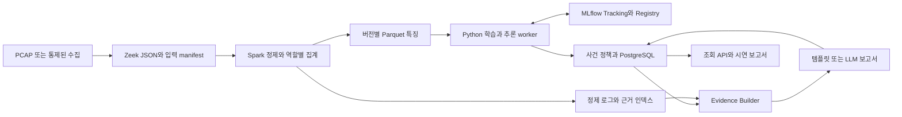

# Zeek 기반 네트워크 이상탐지 프로젝트 — 최종 설계

- 확정일: 2026-11-03
- 개정: 같은 날 프로젝트 폴더에 추가된 원본 PCAP·CSV를 확인하고 데이터 처리·분할 규약을 보완했다.
- 추가 개정: `final-design-verification-results.md`의 C1\~C4를 검토해 자산·정답 대응·평가 단위·동점 규칙을 확정했다.
- 최종 결정: Codex. 사용자가 부여한 설계 결정 권한에 따라 확정한다.
- 상태: 구현의 기준 설계. 모델 성능이나 미실시 검증의 완료를 뜻하지 않는다.
- 범위(2026-11-03 확정 당시): 설계 문서만 작성했다. 프로젝트 구현·모델 학습·서비스 실행은 시작하지 않았다.
- 현재(2026-11-19): 구현이 진행되어 배포 VM에서 실제 트래픽으로 수집부터 보고서까지 돈다. 지금 상태와 남은 일은 [세션 인계](docs/session-handoff.md)에 있다. 확정 뒤 바뀐 결정은 2.2절 `DD-*`이며 본문 문장보다 우선한다.
- 개발 검증 체크리스트: [IMPLEMENTATION_CHECKLIST.md](IMPLEMENTATION_CHECKLIST.md)

이 문서는 구현의 기준이다. 초기안·중간 검토 문서는 정리했고, 필요한 결정과 근거는 최종 설계·체크리스트·검증 결과에 반영했다. 아래 기본값은 성능 최적값이라는 뜻이 아니라, 작은 데이터에서 반복 선택을 피하기 위해 먼저 정한 구현 기준이다. 변경은 이유·사용 데이터·비교 횟수·영향을 기록한 별도 설계 결정으로 남긴다.

## 1. 목표와 완료 범위

> Zeek가 기록한 연결 요약으로 내부 자산의 행동 이상 후보를 찾고, 사건과 근거를 추적하며, AI 보고서가 조사에 주는 추가 가치를 검증한다.

포트스캔을 포함한 여러 행동 변화를 다루되, 모든 공격 유형의 탐지를 보장하는 범용 IDS를 목표로 삼지 않는다. 특히 완료 연결 요약만으로 진행 중인 긴 연결의 행동이나 애플리케이션 공격 성공 여부를 충분히 알 수 없다는 한계를 명시한다.

완료 범위를 두 개로 구분한다.

| 구분 | 필수 결과 |
| --- | --- |
| 첫 제출본 | Zeek → Spark 배치 → 통계·Isolation Forest → 사건 평가 → MLflow 등록 → 근거 조회 → 템플릿·LLM 보고서. 배치 중복 방지와 쓰기 장애 복구 포함 |
| 핵심 완성본 | 첫 제출본 + 파일 Structured Streaming, 실제 수집 시각, 지연 데이터 처리, checkpoint 복구, 모델 교체·재적재·롤백 시연 |

Spark와 MLflow는 필수다. RAG·Jev·LangGraph는 도입 판단에 필요한 자료와 원리 학습을 계획에 포함하되, 운영 경로 편입은 효과와 필요성을 확인한 뒤 결정한다.

WAS 연관 분석, 자동 차단, Kafka, Kubernetes, 대규모 실험망, 초기 그래프 모델·Autoencoder는 범위에서 제외한다(그래프 모델은 뒤에 [DD-007](docs/design-decisions/DD-007-tgn-event-graph.md) TGN으로 추가했다). Spring API, 다중 worker, Airflow는 후속 필요가 생길 때 검토한다.

## 2. 설계 검토에서 확정한 결정

초기 설계와 상호 검토에서 합의한 결정이다. 재승인할 목록이 아니며 각 항목의 상세 규약은 뒤 절에 반영했다.

| # | 검토 항목 | 최종 판단 |
| --- | --- | --- |
| 1 | 설정 선택 기준 부재 | 수용. 5분·conn 중심·공통 전처리·신규성 제외를 기본으로 고정한다. 화요일은 동작 점검에 사용하고 성능으로 설정을 고르지 않는다. 비교 예산과 변경 기준은 6절에 명시한다. |
| 2 | 출발지 신규성 | 수용. 주 모델에서 제외한다. 같은 평가 레코드에 특징만 추가한 비교로 효과와 NAT 의존성을 진단한다. NAT 연결 자체는 삭제하지 않는다. |
| 3 | `_write_ts` 실시간 대조 시점 | 수용. 단계 1에서 수행하며 첫 시간 기반 성능·지연 평가의 선행 조건으로 둔다. |
| 4 | 긴 연결이 상위 N을 점유하는 문제 | 부분 수용. 점유율 측정은 필수다. 정상 구간의 상위 점수라는 이유만으로 바이트 특징을 제거하지 않는다. 의미 오류는 수정하고, 표현 변경은 별도 비교로 기록한다. |
| 5 | 특정 IP 규칙 | 수용. 단계 3의 필수 편향 진단이다. 배포 기준선이나 일반화 가능한 탐지 성능으로 제시하지 않는다. |
| 6 | 작은 보정 표본 | 수용. 사후 사건 Recall@N을 주 지표로 삼는다. 고정 임계값의 경보량·지연은 탐색적 결과다. 제시된 보정 행 수는 새 시간 계약으로 재산출한다. |
| 7 | RAG·LangGraph 판정 자료 | 수용. 단계 5에 지식 오류·근거 누락 기록, MLflow Tracing, 도입/보류 결정서를 포함한다. |
| 8 | 재생 섀도 실행 | 수용. 조건부 확장으로 이동한다. 모델 교체·롤백과 복구는 핵심 완성에 유지한다. |
| 9 | 시각 동률·종료 처리 | 수용. 결정적 보조 키, 캡처 경계, 종료 시 생성 로그의 별도 표기를 규정한다. 마지막 1초 로그를 곧바로 종료 플러시로 분류하지 않는다. |
| 10 | 사건 검증 작업량 | 수용. 사건별 대표 근거와 불확실성 기록을 필수로 하고 조사 시간을 제한한다. 미확인 사건을 억지로 확정하지 않는다. |

### 2.1. 후속 검증 결과 C1\~C4에 대한 결정

대상: [final-design-verification-results.md](final-design-verification-results.md). 기본 구조는 유지하며 아래 변경을 적용한다.

| 항목 | 최종 결정 |
| --- | --- |
| C1 자산 범위 | 수용. CIC의 네트워크·브로드캐스트 주소를 점수화 대상에서 제외한다. 해당 통신 원본과 유효한 출발 자산의 관측은 보존한다. 수신 학습·보류 기대값은 328·77로 수정한다. |
| C2 정답 연결 선택 | 수용. 사건별 선택 조건·버전·검증 범위를 추가한다. UID는 같은 처리 실행 안의 로그 연결에 사용하고, 실행 간 대응은 별도 후보 키와 충돌 검증을 사용한다. |
| C3 정답 단위·중복 | 수용. 주 정답 단위는 공격 에피소드로 고정한다. 자산·역할은 그 하위 관측이다. 일대일 Recall을 유지하고 공격 포함 Recall·중복·예산 점유율을 함께 보고한다. |
| C4 동점 순위 | 수용. 시각 우선 정렬을 고정 해시 순서로 교체하고, N번째 동점 집합의 균등 선택에 따른 Recall 변동을 보조 보고한다. 새로운 탐지 점수를 임의 추가하지 않는다. |

`-C`를 유지해도 영향이 충분히 작다는 해석은 보류한다. 기존 결과를 재현하기 위한 v1 입력 설정은 `-C`로 고정하지만, 옵션 영향의 검증 완료를 뜻하지 않는다. 미세한 패킷 시각 역전도 관측된 규모와 프로토콜 처리 영향의 검증을 구분한다. 세부 상태는 12.3절에 기록한다.

### 2.2. 구현 중 추가한 설계 결정

| 번호 | 내용 |
| --- | --- |
| [DD-001](docs/design-decisions/DD-001-slack-delivery-jev-gate.md) | 최종 보고를 Slack으로 전달한다. Jev는 Slack 전송 여부를 판단한다. 그림자 비교 후 전환하며, 조사 큐는 억제하지 않는다 |
| [DD-002](docs/design-decisions/DD-002-transformer-langgraph-rag.md) | 자기지도 Transformer 비교 모델(단계 3), pgvector RAG와 LangGraph 흐름(단계 5)을 필수로 포함한다. 1·6.2·9.2절의 해당 문장을 대체한다 |
| [DD-003](docs/design-decisions/DD-003-verification-priority.md) | 결과에 영향이 작은 검증을 생략하거나 옮긴다. 실시간 대조는 단계 6으로 옮기고, EOF는 `eof_candidate` 표시로 대신하며, `-C` 비교는 단계 3에서 한다. 2절 #3과 체크리스트 V2 일부를 대체한다 |
| [DD-004](docs/design-decisions/DD-004-spark-standalone-cluster.md) | local에서 검증한 Spark 작업을 이 PC 위 Docker Compose Standalone 클러스터(master 1, worker 2)에도 제출해 결과 동일성과 executor 재시도를 확인한다. 7절의 `local[*]` 단독 실행 문장과 10절 단계 2 완료 기준을 보완한다 |
| [DD-005](docs/design-decisions/DD-005-deadline-scope.md) | 2026-11-19 마감에 맞춰 DD-004 클러스터, 단계 6 스트리밍, 결과 영향이 작은 검증(`-C`·실시간 대조, 손계산 축소)을 미룬다. Spring Boot 관리자 대시보드는 별도 Java 프로젝트로 하고, 단계 4에서 데이터 계약을 고정한다. 1절의 Spring 후속 검토, 10절 단계 6을 대체한다 |
| [DD-006](docs/design-decisions/DD-006-behavior-detectors-reduced.md) | 결과 노출 이후의 설계 변경이다. 자명한 기준선 B(처음 보는 외부 상대 수), 사건 단위 bootstrap 신뢰구간, 행동별 탐지기 3개(first-seen, 내부 fan-out, beaconing), 재처리 없는 Zeek 로그 특징, 커버리지 행렬을 추가한다. 평가 규약은 바꾸지 않는다. Suricata·GAE·합성 주입은 미룬다. 같은 날 수정: 행동 탐지기 확장을 중단하고 ML·DL 모델과 로그 특징을 우선한다 |
| [DD-007](docs/design-decisions/DD-007-tgn-event-graph.md) | 사용자 설계의 TGN 이벤트 그래프 이상탐지. IP 노드·연결 엣지·엣지 정보 모듈 concat, 정상 학습 후 복원 오차와 잠재 이동량으로 판정한다. Zeek run.v2(community_id, FTP USER/PASS)로 재처리한다. 평가 규약은 같다 |
| [DD-008](docs/design-decisions/DD-008-synthetic-apt-injection.md) | 합성 APT 패턴 5개(beacon, 느린 유출, DNS 터널, SMB 측면 이동, 느린 내부 정찰)를 화\~금 Zeek 로그 사본에 conn·프로토콜 로그와 함께 주입한다. 모델은 다시 학습하지 않고, 합성 20건이 분모인 Recall@N으로 평가한다 |
| [DD-009](docs/design-decisions/DD-009-rank-interleave-fusion.md) | 결과 노출 이후의 결정이다. ML·DL 결합은 TGN recon·꼬리 희귀도 v2·Transformer v2의 하루 큐를 순위대로 번갈아 합친다(겹치는 사건은 건너뜀). 점수 척도·꼬리 모양이 달라 점수를 섞지 않는다. DD-002 3절의 합집합 사건 생성을 구체화한다 |
| [DD-010](docs/design-decisions/DD-010-ecs-enrichment-incident-lifecycle.md) | 근거 API·대시보드 필드를 ECS 이름으로 맞추고, 자산 정보는 Zeek kerberos·ntlm 관측만 출처와 함께 쓴다(단계 4). 사건 상태 흐름(열림→확인 중→종료)과 알림 중복 억제를 넣는다(단계 5). 차단 실행·룰 탐지기는 넣지 않는다 |
| [DD-011](docs/design-decisions/DD-011-gemini-decision-model.md) | DD-001의 Slack 전송 판단 모델을 Jev에서 Google `gemini-decision-1`로 바꾼다. DD-001의 안전 조건·그림자 비교는 그대로이고, Jev는 키가 생기면 비교에 추가할 후보로 남긴다 |
| [DD-012](docs/design-decisions/DD-012-file-triggered-pipeline.md) | 새 PCAP 파일 도착으로 시작하는 파일 단위 자동 파이프라인(Zeek → Silver → Gold → 그래프 → 채점 → 근거 → DB)을 범위에 넣는다. 감시 프로그램은 기본으로 꺼 둔다. DD-005의 단계 6 후속은 정식 스트리밍에만 유지한다 |
| [DD-013](docs/design-decisions/DD-013-nas-pc-deployment.md) | 배포를 시놀로지 NAS(수집·Zeek·전처리·CPU 모델·DB·MLflow·API·LangGraph·대시보드)와 PC GPU worker(딥러닝 추론)로 나눈다. 작업은 DB 대기열에서 PC가 가져간다(pull). 수집은 NAS의 tcpdump 컨테이너가 하고, 파이프라인 자기 트래픽은 캡처 필터로 뺀다 |
| [DD-014](docs/design-decisions/DD-014-no-human-labels.md) | DD-001 A단계의 "사람 판단과의 일치"를 뺀다(관제 경험자 라벨 없음). 전송 판단은 정답 에피소드 기준(놓친 공격·불필요한 전송·보낸 수·비용)으로 비교한다 |
| [DD-015](docs/design-decisions/DD-015-vmware-lab-deployment.md) | DD-013을 대체한다. 이 PC의 VMware에 배포 VM 하나(수집·Zeek·전처리·세 모델 CPU 채점·DB·MLflow·API·LangGraph·대시보드)와 Kali VM을 두고, 둘은 격리된 host-only 실습망으로만 연결한다. tcpdump는 실습용 카드만 캡처한다. GPU worker·작업 대기열은 만들지 않는다(추론이 CPU로 충분함을 측정) |
| [DD-016](docs/design-decisions/DD-016-lab-capture-coverage-and-report-refresh.md) | 실습망 수집은 시계 경계(5분)마다 패킷이 없어도 파일을 넘기고, 파일이 덮은 시간의 끝을 캡처 경계로 쓴다(조용한 실습망에서 마지막 공격 창이 채점되지 않던 문제). 사건이 뒤로 늘어나면 보고서를 다시 만들되 Slack에는 다시 보내지 않는다(아직 보낸 적 없는 사건이 보낼 대상이 될 때만 첫 알림) |
| [DD-017](docs/design-decisions/DD-017-lab-background-traffic.md) | 실습망 시험에 정상 배경을 섞는다: CIC 월요일 보류 구간 재생(내부 주소를 10.10.0.100번대로) + 합성 정상(11-17 생성기). 배포 VM이 실습용 카드로 재생해 실제 수집 경로를 탄다. 배경만 → 배경 + Kali 공격 → 배경만 순서의 5분 칸 시간표. 재생·합성 결과는 표시해 실제 관측 주장과 섞지 않는다 |
| [DD-018](docs/design-decisions/DD-018-fusion-merge-overlaps.md) | 결합 v2(`fusion.v2.json`, `overlap_policy: merge_windows`): 여러 모델이 겹쳐 꼽은 사건은 하나로 합치고 범위는 모든 모델 창의 합, 사건 ID는 합친 첫 창으로 다시 만든다. v1(DD-009)은 그대로 두고 등록 모델의 새 버전으로 반영한다. CIC 결합 평가 결과는 v1 기준 |
| [DD-019](docs/design-decisions/DD-019-review-decision-path.md) | 분석가 검토 결정은 대시보드가 DB 함수 `dashboard.decide_review`로 넣고, 멈춘 LangGraph 흐름은 파이프라인(감시 프로그램)이 찾아 재개한다. 근거 API는 읽기 전용 그대로다(Q50 원안 대체) |
| [DD-020](docs/design-decisions/DD-020-lab-segment-sensor.md) | 배포 VM을 실습망 세그먼트 전체를 promiscuous로 보는 센서로 쓰고(수집 명령은 그대로, VMware host-only vmnet이 제3자 유니캐스트를 뿌림을 실측 확인), 공격 대상 VM(lab-target 10.10.0.20, SSH·HTTP·Samba)을 추가한다. 타깃·Kali는 10.10.0.0/24 안이라 자산 설정 변경 없이 채점된다. 시나리오 우선순위는 비커닝 → 느린 스캔 → 느린 유출. 측면 이동은 타깃 복제 뒤 |
| [DD-021](docs/design-decisions/DD-021-queue-eligibility-non-host-only.md) | 자산이 그 창에 건 연결이 전부 호스트가 아닌 주소(내부 대역의 네트워크·브로드캐스트 주소, 제한 브로드캐스트, 멀티캐스트)로 갔고 그 수가 25개(CIC 월요일 정상 창의 최대) 이하인 originator 창은 점수를 남기되 조사 큐에 올리지 않는다(`split = non_host_only`). 채점 worker에서 큐를 만들기 전에 적용하고 모델·특징·묶음은 바꾸지 않는다. 실습망(live) 입력에만 적용하고 CIC·합성 평가는 그대로 둔다 |
| [DD-022](docs/design-decisions/DD-022-incident-reopen.md) | 종결한 사건을 다시 열 수 있게 한다. 새 DB 함수 `dashboard.reopen_incident`가 종결 상태의 사건만 `investigating`으로 돌린다(사유 필수, 이력에 남고 결론은 비운다, 실행 권한은 `dashboard_rw`). `dashboard.transition_incident`는 바꾸지 않아 앞으로만 간다. 파이프라인은 사람이 다시 연 사건을 그보다 앞선 검토 결정으로 다시 닫지 않는다(migration 018) |

## 3. 데이터와 관측 단위

### 3.1. 데이터 선정

주 데이터는 CIC-IDS2017의 PCAP을 직접 Zeek로 처리한 로그다. 원본 CSV·공식 공격 일정·개선 라벨은 정답 후보와 대조 자료로 사용한다. 데이터셋의 기존 flow 특징을 Zeek 특징과 혼합해 학습하지 않는다.

현재 입력 루트는 프로젝트의 `CIC-IDS-2017/`이다. PCAP 5개와 CSV 16개의 전체 SHA-256을 기존 `/home/prosild/src/SentinelFlow/data/raw/CIC-IDS-2017/`의 대응 파일과 비교했고 모두 일치했다. Claude가 참고한 기존 경로와 현재 경로의 원본이 동일하다는 사실을 확인했다. 기존 Zeek 산출물의 실행 설정·계보 검증은 별도로 남는다.

| 실제 입력 | 확인한 구성 | 사용 목적 |
| --- | --- | --- |
| `PCAPs/*.pcap` | 5개, 합계 52,433,389,872 bytes. 확장자는 `.pcap`이지만 실제 형식은 모두 pcapng | Zeek 로그 생성의 원본 |
| `CSVs/TrafficLabelling/*.csv` | 8개, 85열. IP·포트·프로토콜·Timestamp·Label 포함 | 라벨·통신 대응의 참조 자료 |
| `CSVs/MachineLearningCVE/*.csv` | 8개, 79열. Source/Destination IP·Source Port·Protocol·Timestamp가 없음 | 기존 특징·라벨 분포 참고. Zeek 사건의 직접 대응 키로 사용하지 않음 |
| `*:Zone.Identifier` | 확인 당시 21개, 폴더 정리 시 삭제 | `ZoneId=3`만 담긴 다운로드 부가정보. 데이터가 아님 |

원본 21개 파일의 합계는 54,521,141,013 bytes, 약 50.78 GiB다. 여기에 Zeek 로그·Parquet·임시 출력·artifact 공간이 추가로 필요하므로 단계 0에서 디스크 여유를 확인한다. 현재 폴더에는 개선 라벨과 Zeek 산출물이 포함되어 있지 않다. 개선 라벨은 확보·버전 확인 전까지 보유한 입력으로 간주하지 않는다.

**실제 CSV에서 확인한 처리 규칙**은 다음과 같다.

- TrafficLabelling의 목요일 오전 WebAttacks 파일은 헤더 제외 458,968개 레코드 중 288,602개가 모든 필드가 빈 레코드다. 나머지 170,366개와 분리해 품질 통계에 남기고 라벨·정답 집계에서 제외한다. 원본은 수정하지 않는다. 대응 MachineLearningCVE 파일은 170,366행이다.
- 모든 CSV에 공백이 붙은 열 이름과 중복 `Fwd Header Length` 열이 있다. 이름 정리 전 열 위치·원래 이름을 보존하고 명시적 스키마로 읽는다. 조용한 열 덮어쓰기를 허용하지 않는다.
- WebAttacks 라벨의 구분 문자는 TrafficLabelling에서 바이트 `0x96`, MachineLearningCVE에서는 이미 UTF-8 대체 문자 `U+FFFD`다. 파일별 디코딩 규칙과 원문을 보존하고 명시적 라벨 매핑을 사용한다. 두 파일에 동일한 인코딩을 강제하거나 깨진 문자를 임의 삭제해 라벨을 합치지 않는다.
- TrafficLabelling의 월요일 시간 문자열은 초를 포함하지만 나머지 파일은 분 단위이며 AM/PM·시간대가 없다. 오후 파일에도 `1:00`, `3:30`처럼 표시된다. 자동 날짜 추정이나 무조건 24시간 해석을 하지 않는다. 캡처 날짜·범위와 양방향 통신 키로 시간 후보를 대조하고, 애매하면 미확정으로 남긴다.
- CSV flow와 Zeek connection은 방향·분할 단위·시간 정밀도가 같다고 가정하지 않는다. 행 번호로 조인하지 않고, 양방향 통신 키와 시간 후보로 대응한 뒤 일대다·다대일·불일치를 기록한다. CSV 날짜·시각을 모델 특징으로 넣지 않는다.

이미 수\~금요일의 패턴과 통계를 설계자가 관찰했다. 따라서 결과는 **설계 노출을 명시한 회고적 사례 평가**로 표현한다. 외부 일반화를 주장하려면 이후 새로운 데이터나 사전에 보류한 시나리오가 필요하다. CIC 자료의 일정·flow 생성·라벨 문제는 기존 연구에서도 지적됐다. [데이터 소개](https://www.unb.ca/cic/datasets/ids-2017.html), [재검토 연구 자료](https://intrusion-detection.distrinet-research.be/WTMC2021/extended_doc.html)

### 3.2. 자산과 역할

- 단위: `(capture_id, asset_id, role, window_start, feature_version)`.
- 내부 자산 범위는 데이터셋별 설정으로 관리한다. CIC의 시작 설정은 `192.168.10.0/24`다.
- 이 대역의 호스트 주소만 점수화하며 `192.168.10.0`과 `192.168.10.255`는 제외한다. 브로드캐스트·멀티캐스트를 단일 자산으로 만들지 않는다. CIDR 포함 여부만으로 실제 자산을 확정하지 않는다.
- 제외는 점수화 대상 역할에 적용한다. 예를 들어 유효한 내부 호스트가 `.255`로 보낸 연결은 원본과 출발 역할 특징에 남긴다. 연결 레코드 전체를 삭제하지 않는다. `.1`·`.3`은 유효한 호스트 주소로 유지하고 장비·서비스 정체는 별도 근거로 확인한다.
- `role=originator`: 내부 자산이 연결을 시작한 관점. `role=responder`: 내부 자산이 연결을 받은 관점.
- 이 역할은 네트워크 경계의 outbound/inbound와 동일하지 않다. 내부 간 통신은 양쪽 자산의 역할별 관측에 포함한다.
- 자산별 송수신 바이트·패킷 방향을 통일한다. responder에서는 Zeek orig/resp 값을 자산 관점으로 바꾼다.
- 상대 포트는 originator 관점에서 `id.resp_p`, responder 관점에서 `id.orig_p`다. 로컬 포트와 서비스 식별은 별도 필드로 구분한다.
- `local_orig/local_resp`는 설정한 대역과 일치하는지 검사한 뒤 보조적으로 사용한다.
- `172.16.0.1`은 CIC에서 관측되는 NAT 주소다. 공격자의 실체나 일반적인 악성 IP로 취급하지 않는다.
- 활동 없는 창은 주 모델의 행을 생성하지 않는다. 무활동 감지는 별도 요구사항이다. 새 자산에는 공통 모델을 적용하고 이력 부족을 근거에 표시한다.

### 3.3. 로그와 기본 특징

첫 모델은 `conn.log`만으로 시작한다. 다음 특징군을 사용한다.

| 특징군 | 기본 내용 |
| --- | --- |
| 활동량 | 연결 수, 자산 관점 송수신 바이트·패킷의 합 |
| 상대 다양성 | 고유 상대 주소 수, 상대 포트 수. 주소 값 자체는 모델에 전달하지 않음 |
| 연결 상태 | 프로토콜·연결 상태 비율, 미성립·거절 등 정의된 상태의 비율 |
| 지속시간 | 관측 가능한 duration의 중앙값·상위 분위수, 결측 비율 |
| 서비스 구성 | Zeek가 DNS로 식별한 연결 비율과 그 외 연결의 활동량. 미식별은 별도 범주 |

바이트·패킷·개수·지속시간 등 비음수 연속값은 `log1p`를 기본 변환으로 사용한다. 결측과 실제 0을 원본·정제 계층에서 구분한다. 모델 입력에 필요한 대치는 학습 구간 통계로만 수행하고 결측 표시를 보존한다. 분모 0인 비율의 정의도 피처 사전에 기록한다.

IP 원문, UID, 절대 날짜, 공격 일정, CSV 라벨은 학습 특징에서 제외한다. 주소는 집계 키·관계 조회·정답 검증에는 필요하다. 신규 상대 주소 여부, 호스트별 개인화, 역할별 정규화는 기본에서 제외한다. 역할 범주 자체는 공통 모델의 입력에 포함한다.

`dns.log`는 후속 근거 조회용 정제 테이블로 추가할 수 있다. DNS 응답·질의 특징을 모델에 넣는 것은 별도 변경이다. 포트 53이라는 이유만으로 DNS로 확정하지 않는다. DNS 등 일대다 로그를 conn에 직접 조인해 바이트·연결 수를 증식시키지 않는다. 먼저 적절한 단위로 집계하고 조인 전후 건수를 검증한다.

## 4. 시간·가용성 계약

### 4.1. 네 종류의 시각

| 필드 | 의미 |
| --- | --- |
| `ts` | 연결의 첫 패킷 시각 |
| `_write_ts` | 로깅 확장에서 얻은 네트워크 시계 값. 로그 생성 경로를 관측하는 센서 측 대리 시각 |
| `ingested_at` | 수집기가 완성된 입력을 받아 분석에 사용할 수 있게 된 실제 시각 |
| `scored_at` / `delivered_at` | 추론 완료 / 조사 큐 또는 알림 전달 시각 |

저장은 UTC로 통일하고 원본 시간대 변환 근거를 남긴다. `ts + duration`은 연결 끝의 근사치일 뿐 가용 시각이 아니다. `network_time()`은 마지막 처리 패킷 시각이므로 벽시계·디스크 flush 시각과 같다고 가정하지 않는다. [Zeek conn 정의](https://docs.zeek.org/en/lts/scripts/base/protocols/conn/main.zeek.html), [Zeek 시간 함수](https://docs.zeek.org/en/lts/scripts/base/bif/zeek.bif.zeek.html)

### 4.2. 기본 집계와 재생

- 5분 고정 창 `[start, end)`을 UTC epoch에 정렬한다. 배정 필드는 `_write_ts`다.
- 의미는 **그 창에 센서가 기록한 연결 요약의 집계**다. 해당 5분 동안의 실제 회선 전송량이라고 부르지 않는다.
- 초기 재생은 `_write_ts`에서 즉시 수집된다는 이상화된 조건이다. 여기서 얻은 지연을 실제 운영 지연으로 제시하지 않는다.
- 동일 `_write_ts`의 보조 순서는 `(capture_id, log_type, source_file_id, source_row_number)`로 고정한다. 재현을 위한 순서이며 실제 패킷 인과 순서라는 뜻은 아니다.
- `source_file_id`는 입력 manifest에 연결한다. Zeek를 재실행한 결과에는 별도 processing run을 부여한다. UID만으로 재실행 간 동일성을 보장하지 않는다.
- 창의 완료 판단에는 그 창 이후의 입력 진행을 확인해야 한다. 로그가 없는 구간을 행 하나의 시각으로 임의 종료하지 않는다.

원본 5개 모두 `capinfos`의 `Strict time order=False`로 확인됐다. 패킷을 시각순으로 재정렬하면 Zeek의 처리 결과가 바뀔 수 있으므로 원본 순서를 보존한다. 시각 최소·최대와 실제 파일 처리 순서를 구분하며, 원본 패킷의 시각 역전·센서 로그 순서·수집 도착 순서를 각각 확인한다. 기존 월·화요일 conn 로그의 `_write_ts`는 파일 순서에서 감소하지 않았지만 이를 모든 로그·실시간 모드로 일반화하지 않는다. 위 보조 키는 결정적 정렬을 위한 것이며 실제 도착 순서를 대신하지 않는다.

실행 내 로그 조인은 `(processing_run_id, uid)`를 사용한다. 실행 간에는 `(capture_sha256, 원본 정밀도를 보존한 ts, orig 주소·포트, resp 주소·포트, proto)`로 대응 후보를 만들고 중복·누락·방향 변경·분할 차이를 검사한다. 이 자연 키가 언제나 유일하거나 설정 변경에도 불변이라고 가정하지 않는다. 복수 후보는 원본 참조·추가 근거로 해소하고 실패하면 대응 미확정으로 남긴다. 정답의 영속 식별자로 UID나 자연 키 하나만 사용하지 않는다.

### 4.3. 캡처 경계와 긴 연결

PCAP의 패킷 시각 최소·최대와 Zeek 종료 절차를 manifest에 기록한다. EOF 검증에는 실제 처리 순서의 마지막 패킷 시각도 별도로 필요하다. `capinfos -a/-e`는 시각의 최소·최대를 보고하므로 순서상 첫·마지막 레코드와 같다고 가정하지 않는다. [capinfos 공식 설명](https://www.wireshark.org/docs/man-pages/capinfos.html)

처음·마지막의 불완전한 창은 주 점수 비교에서 제외하고 제외량을 보고한다. 해당 구간의 공격 사건을 정답 분모에서 조용히 지우지 않고 경계 영향·미탐 여부를 사건표에 표시한다.

종료 시 강제로 기록된 연결은 확인 가능한 경우 별도 플래그를 붙인다. 확인 불가능하면 `unknown`으로 남긴다. 마지막 1초에 기록됐다는 이유만으로 종료 플러시라고 판정하지 않는다. 마지막 창의 watermark를 넘기기 위해 가짜 연결을 생성하지 않는다. 유한 재생의 잔여 창은 별도 마감·대조 결과로 보존하고 실시간 전달 실적으로 합산하지 않는다.

긴 연결의 총량을 종료 후 과거 창들에 나누어 넣지 않는다. 당시 알 수 없었던 정보가 들어갈 수 있기 때문이다. 월요일 보류 구간에서 상위 N 창과 사건에 대해 다음을 필수 진단한다.

1. 최대 연결의 바이트 점유율과 지속시간.
2. 지속시간 300초 초과 연결이 바이트의 절반 이상을 차지하는 창의 비율.
3. 해당 창의 상위 순위 점유율과 대표 정상 활동 근거.

이 진단은 특징 해석의 문제를 찾기 위한 것이다. 높은 점수를 받았다는 이유만으로 정상이라고 확정하거나 특징을 제거하지 않는다.

## 5. 정답 사건과 평가 규약

### 5.1. 사건 정답

주 정답 단위는 **공격 에피소드**다. 같은 공격 시나리오의 연속 활동은 여러 자산·역할 또는 30분 이상에 걸쳐도 한 에피소드로 두고, 다른 공격 시나리오나 근거로 구분되는 별도 실행은 나눈다. 같은 공격 유형이라는 이유만으로 모두 합치지 않으며 일정표만으로 에피소드를 확정하지 않는다. 자산×역할은 에피소드의 하위 관측과 가시성 분석 단위다. 이 규칙과 에피소드 분할·병합 근거는 단계 0에 정하고, 실제 사건표는 점수를 보기 전에 동결한다.

일별 Recall의 분모는 그 캡처에 검증된 활동이 있는 confirmed 에피소드다. 여러 날짜에 이어지는 공격은 공통 에피소드 ID와 일별 관측을 연결한다. 일별 지표와 전체 고유 에피소드 지표를 구분하고 일별 탐지 수를 독립 공격 수처럼 합산하지 않는다. 정답을 탐지기의 30분 정책에 맞춰 잘게 나누지 않는다.

공식 일정에서 후보를 찾고, 로그와 필요한 PCAP 구간을 확인한다. 정답 사건표에는 다음을 남긴다.

- 사건 ID, 대상 자산·역할, 관측 시간 범위, 관련 연결 또는 패킷의 참조.
- 일정·CSV·개선 라벨의 출처와 불일치.
- 공격 관련 행동의 관측 근거, 시도/성공/성공 미확인 구분.
- `confirmed`, `uncertain`, `unsupported`와 판단 이유. 미확인은 정상과 다르다.
- conn만으로 보이는 것과 보이지 않는 것, 캡처 경계 영향.
- 사건별 재실행 가능한 선택 조건과 버전: 입력 캡처, 대상·상대, 방향·역할, 포트·프로토콜, 시간 필드와 범위, 필요한 추가 행동 조건, 제외 조건. 공격 판정 근거와 조건의 검증 범위를 함께 기록한다.

초기 검토는 사건 후보당 45분을 상한으로 하고, 최대 3개 대표 구간의 근거를 수집한다. 부족하면 `uncertain`으로 남기고 추가 조사가 바꿀 결론을 기록한다. 전수 패킷 감사나 공격 성공 증명을 단계 1 완료 조건으로 요구하지 않는다. 후보가 14개라는 기존 숫자도 확정 정답 수로 사용하지 않는다.

대표 구간은 선택 조건의 타당성을 확인하는 근거다. 몇 개 예시만 확인한 뒤 같은 시간·IP의 모든 연결을 공격으로 확정하지 않는다. 조건이 공격과 정상을 충분히 분리하지 못하면 그 대응은 미확정이며, 검증된 범위로 제한하거나 추가 검토한다. 원래 에피소드의 확인하지 못한 범위를 숨기지 않는다. 정답 선택 조건은 평가 전용이고 모델·LLM의 입력이나 운영 증거 검색 필터에 공격 라벨을 주입하는 용도로 쓰지 않는다.

일정 밖 데이터도 점수화한다. 단지 일정과 겹치지 않는다는 이유로 확정 정상 또는 평가 제외로 취급하지 않는다. 정상 비교 사례는 데이터셋 설명과 실제 근거의 수준을 구분해서 표기한다.

### 5.2. 탐지 사건 생성 기본값

모델 점수는 클수록 이상하게 통일한다. 공격 확률로 해석하지 않는다.

1. 월요일 보류 구간 점수의 95번째 백분위수를 후보 임계값으로 고정한다. 같은 방식으로 각 기준선의 임계값을 정한다. 동률은 `score >= threshold`로 포함한다.
2. 임계값 이상인 5분 창을 후보로 삼는다.
3. 같은 자산·역할의 연속된 후보 창을 병합한다. 창 시작 시각 차이가 5분이면 연속이며, 중간에 후보가 아닌 창이 있으면 끊는다.
4. 첫 후보 창 시작부터 최대 30분까지만 한 사건으로 묶고 이후는 다음 사건으로 분리한다. 캡처 경계·배포 묶음 버전 경계를 넘겨 병합하지 않는다.
5. 사건 점수는 구성 창 점수의 최댓값이다. 동점은 고정 salt `zeek-ad-tie-v1`과 정규화한 `(capture_sha256, asset_id, role, 최초 창 UTC 시각, 마지막 창 끝 UTC 시각)`의 SHA-256 오름차순으로 정렬한다. 직렬화 규칙을 버전 관리하고 동일 입력에 같은 결과를 낸다. 라벨·모델 점수·UID·실행 ID를 해시 입력으로 쓰지 않으며 유리한 salt를 탐색하지 않는다.
6. 운영에서는 첫 후보에서 사건을 열고 같은 사건의 후속 창은 갱신한다. 최초 전달과 이후 점수 변경을 모두 기록한다.

95%와 30분은 사전 정책 기본값이며 작은 표본에서 검증된 운영 최적값이 아니다. 연속 창의 의존성과 모델별 후보 수 차이를 보고한다. 후보 이하 점수도 저장하며 임계값이 놓친 사건과 일별 순위 제한으로 빠진 사건을 구분한다.

동점은 저장된 점수 값 기준으로 판정하며 화면 표시용 반올림으로 동점을 만들지 않는다. 고정 해시는 재현 가능한 사후 큐의 순서를 정하는 수단이며 보안 우선순위 점수가 아니다. 실시간 최초 전달은 실제 도착·확정 순서에 따른다.

### 5.3. 사건 대응과 지표

주 지표는 **관측된 하루의 사후 조사 큐에서 사건 Recall@10**이다. 5/20/50은 민감도 표로 함께 보고한다. 후보가 N개 미만이면 실제 개수만 사용한다. 하루 전체 점수로 정렬한 결과를 실시간 경보 성능으로 표현하지 않는다.

정답 대응은 자산·역할·시간 중첩만으로 성공 처리하지 않는다. 후보 창에 포함된 연결 근거가 검증된 공격 관련 통신과 연결되는지도 확인한다. 긴 연결의 경우 기록 창과 통신 발생 시간이 다를 수 있으므로 연결 참조로 대응한다. 혼합 창에 공격 연결이 하나라도 있다고 전체 창의 모든 연결을 공격으로 라벨링하지 않는다.

5.1절의 선택 조건을 검증된 범위에서 실행해 연결 대응표를 만든다. 이 표는 선택 조건 버전·입력 실행·근거 참조와 함께 보존한다. 근거가 불확실한 대응은 confirmed 대응의 간선으로 사용하지 않는다.

한 정답 에피소드는 하루의 Recall 분자에 한 번만 기여한다. 주 지표는 상위 N 예측 사건과 confirmed 에피소드 사이의 **최대 개수 일대일 대응**으로 계산한다. 최대 대응이 여러 개라면 정렬된 예측 ID·정답 ID 순으로 재현 가능한 해를 선택한다. 같은 공격에 중복 경보를 내면 추가 Recall 이득은 없고 조사 예산은 소모한다.

보조 지표인 **공격 포함 Recall@N**은 상위 N 사건 중 하나 이상에 검증된 근거가 있는 고유 에피소드의 비율이다. 일대일 제약을 풀어 한 사건이 복수 공격을 포함한 경우도 보여 주되, 같은 에피소드를 반복 탐지해도 한 번만 센다. 주 지표와의 차이로 사건 분할·병합의 영향을 드러낸다.

공격별로 전체 후보 및 상위 N에서 대응 사건 수, `max(대응 사건 수-1, 0)`인 추가 사건 수, `상위 N 대응 사건 수 / 실제 큐 크기`인 예산 점유율을 보고한다. 한 사건이 여러 공격을 포함하면 공격별 점유율 합계는 100%를 넘을 수 있으므로 중첩 관계를 함께 공개한다. 같은 공격을 반복 조사하는 비용과 탐지 자체의 가시성을 구분한다.

N번째 경계에 동점 집합이 걸리면 동점 수·남은 자리 수와 **동점 선택에 따른 Recall 민감도**를 추가 보고한다. 경계 동점에서 남은 자리만 균등하게 비복원 선택해 1,000회 계산하고 seed 42를 고정한다. 주·보조 Recall의 평균, 관측 범위, 평균의 Monte Carlo 표준오차를 기록한다. 이는 동점 선택에 대한 근사 기대값이며 공격 표본의 신뢰구간이 아니다. 기본 고정 해시 결과를 이 평균으로 몰래 대체하지 않는다.

함께 보고할 결과:

- confirmed 사건 수, 탐지·미탐 목록, uncertain 후보 수와 검토 범위.
- 검토한 상위 N의 공격 관련/정상 근거 있음/판단 불가 비율. 미라벨을 전부 FP로 세지 않는다.
- 역할별·자산별·행동별 결과, 후보 수, 경계 영향, 중복 사건 수.
- 고정 임계값의 최초 전달 지연, 미탐, 캡처 종료로 관측이 잘린 경우. 지연은 탐색적으로 보고한다.
- 관측 시간당 조사량. 불완전한 캡처를 24시간 서비스 운용 실적으로 환산하지 않는다.

## 6. 분할·모델·설정 변경 규칙

### 6.1. 분할과 기본 모델

월요일 캡처의 최소·최대 패킷 시각 사이 80% 지점을 분할 기준으로 삼는다. 그 지점을 포함하는 5분 창 전체를 제외하고 앞의 완전한 창은 학습, 뒤의 완전한 창은 보류로 사용한다. 행 무작위 분할이나 자산별 서로 다른 시각 분할을 하지 않는다.

현재 원본에서 확인한 구간은 다음과 같다. 모두 2017-07-03 UTC이며 반열린 구간이다.

| 항목 | 확정한 시각·규칙 |
| --- | --- |
| 캡처 최소·최대 | 11:55:58.598308 \~ 20:01:34.472889 |
| 80% 기준 시각 | 약 18:24:27.297973 |
| 학습 창 | `[12:00:00, 18:20:00)` |
| 분할 경계 제외 창 | `[18:20:00, 18:25:00)` |
| 보류 창 | `[18:25:00, 20:00:00)` |
| 캡처 양끝 | 12:00 이전과 20:00 이후에 걸친 불완전 창 제외 |

기존 `_write_ts` 로그에 이 규칙과 3.2절의 호스트 주소 제외를 적용하면 출발 역할은 학습 958·보류 235개, 수신 역할은 학습 328·보류 77개다. 합계는 학습 1,286·보류 312개다. 이전 수신 수치 404·96에는 `.255`의 학습 76·보류 19개가 포함돼 있었다. 이는 **사전 점검 수치**이며 새 Spark 파이프라인의 품질 처리·EOF 검증 후 최종 행 수를 대조한다. 그때 달라진 행의 이유를 남긴다. 작은 보류 표본이라는 판단은 유지한다.

화요일은 파이프라인·대응·사각지대의 개발 점검에 사용한다. 수\~금요일은 동결 후 회고적 평가에 사용한다. 이미 노출된 데이터를 독립 테스트라고 부르지 않는다.

필수 비교는 다음 세 개다.

| 항목 | 결정 |
| --- | --- |
| 통계 기준선 | 학습 구간 특징별 경험적 분포에서 양쪽 꼬리의 희귀도를 계산하고 가장 큰 값을 창 점수로 사용. 이산값 동률·상수 특징 처리를 명시하고 역할 범주는 점수 계산에서 제외 |
| 주 ML 모델 | 두 역할의 행을 함께 학습하는 하나의 Isolation Forest. 역할 범주 포함. 기본 200 trees, `max_samples=min(256, 학습 행 수)`, seed 42. 점수 방향과 별도 후보 임계값을 명시 |
| 편향 진단 | 특정 NAT 주소의 활동 유무를 사용한 진단. 동일 사건 대응 규약으로 비교하고 주소를 알게 된 경위를 공개. 배포 제외 |

전처리는 학습 구간에서만 적합한다. Isolation Forest의 내장 contamination 판정을 프로젝트 경보 정책으로 그대로 쓰지 않는다. 학습·추론은 집계 후 작은 행렬을 사용하는 Python worker가 맡는다. Spark MLlib나 분산 학습을 필수로 만들지 않는다.

### 6.2. 비교 예산과 변경 기준

첫 평가 전에 기본 설정을 고정한다. 선택 실험은 최대 네 개의 단일 변경 비교로 제한한다: 1분 창, 신규성 추가, 역할별 전처리, 사전에 정의한 바이트 표현 변경. 모든 조합을 탐색하지 않는다. DNS 로그 특징·모델 확장은 이 예산에 끼워 넣지 않고 다음 버전의 별도 실험으로 둔다.

실험 전 가설·변경 하나·관측 지표·사용 구간을 MLflow에 기록한다. 기본 구성의 변경 기준은 다음과 같다.

- 시간·방향·중복·결측 정의가 틀리거나 수작업 표본과 불일치하면 수정한다. 이는 성능 최적화가 아니라 오류 수정이다.
- 실행 불가능한 메모리·처리량 문제가 있으면 측정한 자원 한계에 맞춰 수정한다.
- 월요일의 점수 분포·상위 N·역할 편중은 실패 분석에 사용한다. 정상 데이터만으로 공격 탐지력이 좋아졌다고 선택하지 않는다.
- 화요일 Recall이 좋아졌다는 이유로 기본값을 교체하지 않는다. 문제가 발견되면 수정 목적과 노출 사실을 기록하고 기존 결과와 분리한다.
- 평가 결과를 보고 수정했다면 새 버전이다. 같은 평가셋 재사용 사실과 시도 횟수를 공개한다.

신규성 비교는 월요일 이력만 기준으로 정의하고 평가 중 미래 이력을 조회하지 않는다. `.50`에서 보인 NAT 의존성은 전체 자산으로 일반화하지 않는다. 신규성 제외 후 성능 하락도 숨기지 않는다.

## 7. Spark 파이프라인과 시스템 구조

### 7.1. 저장과 실행

- Bronze: 변경하지 않는 Zeek 원본, PCAP 참조, 해시·실행 manifest.
- Silver: 명시적 스키마·UTC·결측을 적용한 로그, 품질 오류 격리, 원본 참조.
- Gold: 역할별 시간창 특징과 evidence 참조, 특징 버전·입력 manifest ID.
- 로컬 Parquet를 사용하고 캡처·로그 종류 등 소수 키로 분할한다. IP별 파일 분할을 하지 않는다.
- PySpark DataFrame·Spark SQL로 수집 이후 변환을 구현한다. 초기 실행은 단일 머신 `local[*]`이며 다중 노드 처리 실적을 주장하지 않는다.
- 추론 worker는 완성된 특징 묶음을 읽고, 점수·사건을 트랜잭션으로 저장한다. Spark executor에서 행마다 HTTP 추론을 호출하지 않는다.
- PostgreSQL에 사건·점수·근거 참조·작업 상태를 저장한다. MLflow도 같은 PostgreSQL 서비스의 별도 DB와 계정을 사용하고 artifact는 로컬 영속 볼륨에 둔다.
- 얇은 FastAPI 조회 계층을 두고 시연은 API 결과와 정적 보고서로 시작한다. 별도 프런트엔드·Spring 이중 API는 초기 필수가 아니다.

명시적 스키마, 실행 계획, partition·shuffle, 집계와 조인의 증식, 캐시의 필요성을 실제 작업으로 학습한다. 소규모 데이터를 Spark로 처리하는 학습 목적과, 실측한 처리 성능을 구분해서 설명한다.

원본 입력은 `CIC-IDS-2017/`에서 읽고 생성 로그·Parquet는 별도 산출물 루트에 쓴다. 경로는 설정으로 전달하며 기존 분석 스크립트의 SentinelFlow 절대 경로를 새 구현에 복사하지 않는다. CSV 참조 테이블도 3.1절의 빈 레코드·열 이름·라벨 인코딩·시간 모호성 규칙을 적용하고 품질 처리 전후 건수를 남긴다.

### 7.2. 배치 복구

입력 manifest와 출력 버전을 기준으로 작업을 식별한다. 파일 출력은 임시 위치에 완성한 뒤 검증된 manifest를 게시한다. 부분 결과를 완료 결과로 읽지 않는다. PostgreSQL에는 입력·모델·정책 버전을 포함한 유일 키를 사용한다.

재실행, 파일 작성 중 중단, DB commit 전후 중단을 각각 확인한다. Parquet와 DB를 하나의 원자적 트랜잭션이라고 주장하지 않는다. manifest·작업 상태와 재처리 규칙으로 복구하고 누락·중복을 대조한다.

### 7.3. 스트리밍 핵심 완성

완성된 불변 파일만 수신 디렉터리에 원자적으로 배치한다. 작성 중인 Zeek 로그 파일을 그대로 파일 스트리밍 입력으로 사용하지 않는다. 이 요구는 Spark 파일 소스의 전제다. [Spark 파일 소스](https://spark.apache.org/docs/4.1.2/streaming/apis-on-dataframes-and-datasets.html)

집계 배정 시각은 배치와 동일한 `_write_ts`로 유지하고 `ingested_at`을 별도 기록한다. 기본 출력 정책은 watermark 후 확정 창을 쓰는 Append로 한다. 중간 결과를 이용한 조기 알림은 후속 변경이다. watermark는 센서 시각 기준의 상태 정리 정책이며 벽시계 타이머가 아니다.

허용 지연 값은 단계 6의 실제 수집·재생 실험에서 파일 회전·전송 지연을 측정한 뒤 고정한다. 처리 순서 뒤바뀜과 허용 범위 밖 도착을 별도 시험한다. 늦은 데이터는 원본에 보존하고, 운영 경로에서 제외된 양과 별도 재처리 결과를 기록한다. 사후 수정 결과를 당시 실시간 탐지 성공으로 소급하지 않는다.

checkpoint 복원과 DB의 멱등 쓰기를 함께 검증한다. `foreachBatch` 사용만으로 end-to-end exactly-once를 주장하지 않는다. 입력이 멈추면 마지막 창 확정도 지연될 수 있으므로 정지 구간·유한 재생의 마감 규칙을 따로 검증한다. [Spark 출력·복구 규약](https://spark.apache.org/docs/4.1.2/streaming/apis-on-dataframes-and-datasets.html)

## 8. MLflow와 모델 운영

첫 학습부터 입력 manifest, 분할 경계, 피처 정의, 코드 버전, 의존성, seed, 모델 설정, 점수 분포, 사건 지표, 실패 사례를 MLflow에 기록한다. 데이터 파일 전체를 매 실행마다 MLflow에 복제하지 않고 추적 가능한 참조·해시를 연결한다.

배포 단위는 **모델 + 전처리 + 피처 스키마 + 후보 임계값 + 사건 정책 + 호환성 정보**다. Registry 모델 버전과 이 묶음의 manifest를 연결한다.

승격 조건은 수치 하나의 우승이 아니다. 스키마 호환, 재현성, 알려진 실패의 검토, 고정 사건 비교, 메모리·지연 측정, 복구 통과를 체크하고 수동 승격한다. 역할별 악화와 불확실한 개선은 그대로 기록한다. 드리프트가 보였다는 이유로 자동 재학습·승격하지 않는다.

작업 시작 또는 명시적 재적재 시 alias를 실제 모델 버전으로 해석해 고정한다. alias 변경만으로 실행 중 worker가 바뀌었다고 보지 않는다. [MLflow Registry](https://mlflow.org/docs/latest/ml/model-registry/)

교체·롤백 시연은 새 작업 경계에서 묶음을 적재하고, 실제 사용 버전·샘플 추론·스키마를 확인한다. 진행 중 사건은 기존 버전으로 마감하거나 분리하며 한 사건에 두 모델 점수를 섞지 않는다. 이전 묶음 복원 후 실제 추론 버전까지 확인해야 롤백 완료다.

운영 관측 항목은 입력량·결측·스키마 오류·지연·역할별 특징과 점수 분포·후보 수·추론 실패·사용 버전·LLM 비용이다. 소수 표본의 분포 변화는 조사 신호로 취급한다.

## 9. LLM·RAG·LangGraph·Jev

### 9.1. 첫 제출의 AI 기능

Evidence Builder가 사건의 특징, 비교 기준, 관련 연결 수, 시간 범위, 관측 한계와 근거 ID를 계산한다. 같은 입력으로 고정 템플릿과 LLM 1회 보고서를 비교한다. LLM은 탐지기·정답 생성기·자동 차단기로 사용하지 않는다.

첫 입력은 허용 목록에 있는 숫자·불리언·검증된 열거값·생성한 식별자와 고정 설명으로 제한한다. 도메인·URI·사용자 문자열·자유 형식 오류 메시지를 보내지 않는다. IP와 날짜는 관계를 보존하는 가명·상대 시각으로 치환한다. 익명화가 데이터셋 암기를 완전히 제거한다고 주장하지 않는다.

보고서 필드는 관측 요약, 근거 ID별 주장, 가능한 설명, 판단 한계, 추가 확인 항목이다. 각 주장에 대해 수치뿐 아니라 자산·방향·시간·단위가 일치하는지도 평가한다. 실패·시간 초과·형식 오류 시 템플릿을 사용하고 탐지 사건은 보존한다. LLM 실패가 조사 큐 자체를 지우지 않는다.

### 9.2. 평가와 도입 판단

탐지기와 사건 집합을 먼저 고정한다. AI 개발은 화·수요일 사례, 목·금요일은 프롬프트·모델 ID·채점표 동결 후 출력 비교에 사용한다. 사건 내용은 이미 노출됐으므로 독립 평가라고 부르지 않는다. 가능하면 방식 이름을 가리고 무작위 순서로 사람이 채점한다.

MLflow Tracing으로 입력 버전·근거 조회·호출·출력·검증·비용을 기록한다. 민감한 원문을 trace에 넣지 않는다. 근거 없는 주장, 잘못된 ATT&CK 후보, 누락된 관측, 읽는 시간, 지연·비용, 입력 경계 위반을 측정한다.

| 기술 | 해결할 문제와 도입 조건 |
| --- | --- |
| RAG | 외부 지식 부족으로 생긴 오류·누락이 확인될 때. MITRE ATT&CK 등 버전 고정 문서를 대상으로 키워드 검색을 먼저 비교하고, 검색 정확도와 보고서 개선을 각각 측정한다. ATT&CK 매핑은 행동 설명의 가설이며 공격 정답이 아니다. |
| LangGraph | 근거에 따라 조회가 분기되거나 상태 저장·검토 대기·재개가 필요할 때. 고정 조회의 누락 원인이 자료 부재라면 그래프를 추가하지 않는다. 먼저 일반 함수 흐름으로 요구를 확인한다. |
| TypeSafe AI Jev | 명시적인 조사 우선순위 정책과 사람의 비교 판단이 준비됐을 때. 정책 규칙·일반 LLM·Jev를 같은 사건에서 비교한다. confidence를 실제 정확도로 해석하지 않는다. 알림 보류·추가 검토 의견을 기록하되 초기에는 원래 조사 큐를 자동 억제하지 않는다. |

단계 5에서 각 기술에 대해 도입/보류 이유를 문서화한다. 필요하면 작은 학습 예제로 원리를 익히되 주 시스템 기능과 구분한다. RAG나 원문 입력을 추가할 때는 검색 문서·도구 응답도 비신뢰 입력으로 취급하고, 정상 반복 변동을 포함한 예산 제한 인젝션 시험을 추가한다.

Jev의 공급자·모델 ID와 API 형식은 연동 시 공식 문서로 확인하고 고정한다. [Jev 모델 문서](https://docs.typesafe.ai/models), [confidence 설명](https://docs.typesafe.ai/confidence), [LangGraph 개요](https://docs.langchain.com/oss/python/langgraph/overview)

## 10. 단계별 구현·학습 순서

각 단계는 **개념 설명 → 사용자가 이해할 작은 구현 → 실행 → 정상·실패 사례 확인 → 본인 말로 설명 → 결과 기록** 순서로 진행한다. 코드를 한 번에 생성하지 않는다. 다음 단계로 가기 위해 전체 프로젝트를 다시 승인받지는 않는다.

| 단계 | 구현·학습 내용 | 완료 기준 |
| --- | --- | --- |
| 0 | 원본·자산·시간·정답 에피소드·노출 이력 규약, 환경 자원 확인 | 자산 제외와 에피소드 분할·병합 규칙 고정. 공격 후보 하나·정상 비교 하나의 관측 의미, 입력 경로·버전·라이선스·분할 기록 |
| 1 | 작은 PCAP의 Zeek 실행, `_write_ts`와 통제 실시간 대조, 제한된 사건 근거 검토 | 시간·종료·checksum 옵션 영향 확인, 실행 간 연결 대응 검사, 사건 선택 조건·대표 근거·불확실성. 모든 사건을 확정할 필요는 없음 |
| 2 | Spark 명시적 스키마, 정제, 역할별 5분 집계 | 손계산 표본 일치, 결측·중복·역할 전환·경계 검증, 재실행 동일성, 실행 계획 설명 |
| 3 | 사건 생성·대응 평가기부터 구현, 통계·IF·편향 진단, MLflow Tracking | 동결 후 일대일·공격 포함 Recall, 중복·예산 점유·동점 민감도 평가. 긴 연결·NAT·역할 편중·미탐과 후보 생성·순위 손실 공개 |
| 4 | Registry 묶음, 추론 worker, PostgreSQL, 근거 조회 API | 입력부터 사건까지 추적, 배치 중복·쓰기 중 장애 복구, 실제 모델 버전 확인 |
| 5 | Evidence Builder, 템플릿·LLM 1회 보고서, Tracing | 고정 사례 비교, 입력 경계 검증, RAG·LangGraph·Jev의 도입 판단 자료. 첫 제출본 완료 |
| 6 | 파일 스트리밍, 수집 시각, watermark·Append·지연 정책, checkpoint | 배치와 허용 지연 조건을 맞춘 결과 대조, 지연·재시작·쓰기 실패 검증 |
| 7 | 모델 교체·재적재·롤백, 상태·실패 관측 | 실제 버전 전환·복구와 재현 가능한 시연. 핵심 완성본 완료 |

후속 확장은 해결할 문제에 따라 선택한다. 독립 성능 주장이 목적이면 새로운 평가 데이터 확보를 복잡한 모델 도입보다 앞에 둔다. 재생 섀도 실행은 버전별 상태·오류 경로를 비교할 필요가 생겼을 때 추가한다.

## 11. 검증·포트폴리오 제출물

| 보여줄 역량 | 제출할 증거 |
| --- | --- |
| 데이터 엔지니어링 | raw→silver→gold 계보, 스키마·시간 계약, Spark 실행 계획, 처리량·메모리 실측, 품질 오류 사례 |
| ML | 기준선과 IF의 동일 규약 비교, 사건 Recall@N, 역할·긴 연결·NAT 편향 진단, 미탐 설명 |
| MLOps | MLflow run→모델 버전→배포 묶음→사건 연결, 재실행·장애 복구·실제 롤백 시연 |
| AI 시스템 | 템플릿 대비 LLM 효과·비용, 근거 없는 주장, 입력 경계 시험, 선택 기술의 도입/보류 근거 |
| 보안 분석 | 라벨 출처·불일치·불확실성, 관측 가능한 행동과 공격 성공의 구분, 데이터셋 한계 |
| 개발·학습 | 작은 변경 이력, 직접 설명 가능한 구성요소, 실패 후 수정의 근거 |

정확도 숫자 하나보다 재현 가능한 평가, 실패 설명, 복구 검증을 중심으로 README·시연·기술 설명서를 작성한다. 작은 호스트 집계 데이터에서 대규모 모델이나 분산 운영 실적을 과장하지 않는다.

## 12. 이번 검토에서 확인한 사실과 남은 검증

### 12.1. 앞선 검토: 기존 Zeek 산출물

Claude의 기존 스크립트와 산출물을 읽고, 기존 Parquet의 월·화요일 부분 및 월요일 원본 JSON을 읽기 전용으로 재집계했다. 이 검토의 한계는 원본 데이터가 다르다는 뜻이 아니라, 실행 설정·시간 의미·집계 기준을 구분해야 한다는 뜻이다.

아래는 최초의 주소 접두사 기준 측정 이력이다. 브로드캐스트를 제외한 현재 학습·보류 기대값은 6.1절과 12.3절을 따른다.

| 항목 | 확인 결과와 해석 |
| --- | --- |
| 월요일 5분 창 | `ts` 기준 출발 1,220·수신 517. `_write_ts` 기준 출발 1,227·수신 516. 기존 숫자를 새 계약의 표본 수로 그대로 사용할 수 없음 |
| 월요일 duration | 원본 375,432행 중 필드 부재 6,724행, 명시적 null 0행, 존재하면서 0인 값 0행. 약 1.79% 결측은 이 파일에서 확인됨. 다만 중간 Parquet는 결측을 0으로 바꿔 구분을 잃음 |
| 시각 동률 | `_write_ts` 동률에 속한 행은 월요일 296,730/375,432, 화요일 247,935/323,342. 보조 키 필요 |
| 긴 연결 지배 창 | 월요일 출발 역할에서 1,227개 중 17개. 한 연결이 창 바이트의 절반 이상이며 지속시간 300초 초과. 실제 모델 상위 N 점유율은 아직 미측정 |
| 신규성 | 화요일 수신 역할 445개 창 중 69개에 신규 출발지, 그중 38개는 NAT 주소 활동과 무관. `.50`의 98개 창에서는 신규 출발지가 있는 31개 모두 해당 NAT 활동과 겹침. 특징 수준 관찰이며 모델 기여도는 미측정 |
| 보류 표본 수 | `an6.py`의 244·101은 이전 `ts` 기준 결과 참조값. `_write_ts`·경계 제외 적용 시 출발 235·수신 96개였고, 이후 브로드캐스트 자산 제외로 수신 77개로 수정. 현재 기준은 6.1절 |
| 종료 플러시 | `an6.py`는 최대 기록 시각의 마지막 1초를 센다. 실제 EOF 원인이나 마지막 패킷을 검증한 결과가 아님 |
| 상위 k 대리 실험 | `an5.py`는 창 크기를 유지한 점수 순열 대조를 포함함. 연결 수 의존성 경고는 단순 상관보다 강하지만 실제 AE 점수의 결과는 아님 |

Claude 문서의 “월·화요일만 사용” 설명과 “5일 전체 지연” 표기는 범위를 구분해야 한다. 이번 재검토는 그 5일 전체 지연 통계를 재계산하지 않았다.

### 12.2. 원본 추가 후 확인: 파일 동일성·형식·시간·CSV 품질

현재 PCAP 5개를 `capinfos 4.2.2`로 끝까지 읽어 파일 형식·패킷 수·시간 범위·시간 순서·SHA-256을 확인했다. CSV 16개는 레코드를 순회해 열·행 수·라벨·시간 문자열 형식을 확인하고 해시를 계산했다. 기존 경로의 원본 21개도 해시로 비교해 전부 일치함을 확인했다. 공식 배포본의 별도 체크섬과 대조했다는 뜻은 아니다.

| 날짜 | 패킷 수 | 최소\~최대 패킷 시각, UTC |
| --- | --- | --- |
| 2017-07-03 월 | 11,709,971 | 11:55:58.598308 \~ 20:01:34.472889 |
| 2017-07-04 화 | 11,551,954 | 11:53:32.364079 \~ 20:00:31.076755 |
| 2017-07-05 수 | 13,788,878 | 11:42:42.084372 \~ 20:10:19.780725 |
| 2017-07-06 목 | 9,322,025 | 11:58:58.492265 \~ 20:04:44.364012 |
| 2017-07-07 금 | 9,997,874 | 11:59:39.599128 \~ 20:02:41.169108 |

CSV 두 종류는 각각 비어 있지 않은 레코드가 총 2,830,743개다. 같은 수라고 해서 두 종류의 행별 대응이나 CSV↔Zeek 일대일 대응이 검증된 것은 아니다. 목요일 오전 TrafficLabelling의 전 필드 빈 레코드 288,602개는 이 수에서 제외했다.

추가 열람 범위는 5일 PCAP의 메타데이터·해시, 16개 CSV의 스키마·라벨 분포·시간 형식, 월·목·금 CSV 첫 레코드의 통신 대응 표본, 월요일 기존 Zeek 로그의 분할 재집계다. 이를 평가 데이터 노출 이력에 추가한다. 새로운 모델 학습·공격 탐지 성능 평가·전체 패킷의 공격 판별은 수행하지 않았다.

핵심 설계는 유지하고 원본 경로·CSV 처리·시간 순서·분할 규칙을 보완했다. 해시와 남은 확인 범위는 [개발 검증 체크리스트](IMPLEMENTATION_CHECKLIST.md)에 기록했다. PCAP을 다시 Zeek로 처리하지 않았으며 원본 데이터는 수정하지 않았다.

### 12.3. 후속 검증 결과의 검토 범위와 유보한 해석

Codex는 `an7.py`를 읽고 읽기 전용으로 재실행해 기존 집계와 동점 결과를 재현했다. 별도로 CIDR의 호스트 주소 집합으로 계산해 `.255` 수신 1,110행, 제외 후 수신 학습 328·보류 77개를 확인했다. conn 로그 5개의 SHA-256도 Claude의 보고값과 일치했다. 브로드캐스트 제외 전 수신 전체 516개 창은 제외 후 418개가 된다. 학습·보류·분할 경계 제외·캡처 양끝 제외는 각각 328·77·4·9개다.

동점 실험은 확정 피처·정제 모델의 결과가 아니다. `.255`를 포함하고 duration 결측이 0으로 대치된 기존 Parquet를 사용했으며, 상대 포트도 양 역할 모두 `resp_p`로 근사했다. 월·화요일의 통계 기준선 점수를 계산한 것이므로 신경망/IF 학습은 없었어도 경험분포를 추정한 탐색 실험이며 노출 이력에 포함한다. IF도 동일 특징 벡터 등에서 동점이 생길 수 있으므로 연속형 점수라는 이유로 검증을 생략하지 않는다.

Claude가 보고한 최대 12\~18µs 패킷 시각 역전과 실제 마지막 패킷 시각은 파서 소스를 검토했으나 Codex가 5일 PCAP을 다시 순회해 독립 재현하지 않았다. 5분 집계의 큰 순서 문제를 시사하는 결과는 아니지만, 프로토콜 분석 영향이나 EOF 강제 기록의 원인이 없다는 증명은 아니다. 실시간·타임아웃·EOF 통제 검증은 유지한다.

기존 실행 환경은 Claude 확인 결과로 Zeek 8.0.10, 이미지 `zeek/zeek@sha256:73e80e9cd23ff71fd28d158e9a9af5c7b2b0ef5d4036af61521827531347c0e3`, 실행 `zeek -C -r <pcap> ext.zeek`다. `Site::local_nets`는 비어 있고 사설 주소를 local로 보는 기본 설정이었다. 자산 판정은 이 기본값 대신 3.2절 설정을 따른다. Codex가 이번에 이미지 자체를 실행·검증한 것은 아니다.

v1은 재현성을 위해 기존 `-C`를 명시적으로 유지한다. 이 옵션은 checksum 검사를 생략한다. [Zeek 공식 설명](https://docs.zeek.org/en/lts/quickstart.html) Claude의 월요일 비교에서 conn 수 차이는 11개지만 `SF` 수 차이는 587개였다. 집계 건수만으로 영향이 작다고 결론 내리지 않는다. 단계 1에서 기존 두 출력을 이용해 대응 연결의 상태·바이트·패킷·시간창 특징 차이를 확인하고, 단계 3에서 후보·순위 영향을 보고한다. `weird.log` 건수를 잘못된 checksum 패킷 총수로 해석하지 않는다. 중대한 의미 차이가 확인되면 입력 설정을 새 버전으로 변경하고 동일 조건에서 다시 평가한다.

장시간 Bot·스캔과 4분 간격 공격은 중복·병합 가능성을 보여 주는 사례다. 일정 길이만으로 실제 후보 사건 수를 확정하지 않는다. 예를 들어 94분 PortScan이 최소 4개 예측 사건을 만든다는 주장은 전체 기간에 후보 창이 연속된 경우에만 성립한다. 후보 생성 결과와 정답 구성을 구분해 보고한다.

설계는 확정됐으며 단계 0부터 프로젝트를 시작한다. 입력·시간·라벨·운영 가정의 검증은 개발 단계별로 수행한다. 완료 조건은 [개발 검증 체크리스트](IMPLEMENTATION_CHECKLIST.md)에 정리했다. 검증 실패가 나면 해당 계약과 결과의 영향을 수정하고 기록한다. 검증되지 않은 값을 완료된 사실로 채우지 않는다.
