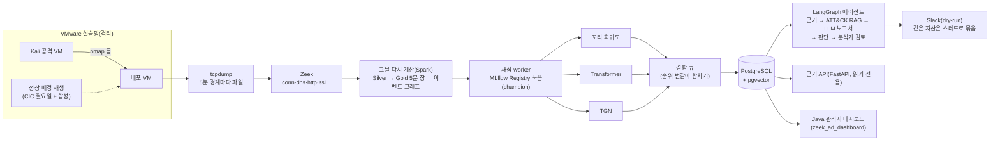

# zeek_AD: Zeek 로그로 내부 자산의 행동 이상을 찾는 end-to-end 파이프라인

네트워크 센서(Zeek)의 연결 로그만으로 내부 호스트의 평소와 다른 행동을 찾는다. 찾은 행동은 조사 큐에 올리고 근거·LLM 보고서·알림까지 만든다. 공개 데이터(CIC-IDS-2017)로 모델을 만들고 평가했다. 그다음 격리된 VMware 실습망에서 실제 트래픽(Kali 공격 + 정상 배경)을 발생시켜 수집부터 알림까지 자동으로 도는 것을 확인했다.

목적은 성능 수치가 아니라 실제 트래픽이 들어와 조사 큐와 보고서가 나오기까지 전 과정을 만들고 단계마다 결과를 측정하는 것이다. 모델 세 개(통계 기준선인 꼬리 희귀도, Transformer, 시간 그래프 신경망 TGN)는 월요일 정상 트래픽으로만 학습했고 라벨은 평가에만 썼다.

세 모델의 결합 큐는 CIC 확정 공격 16건 중 14건을 하루 상위 50 안에 올렸다. 상위 10에서는 NAT 주소와의 연결 수만 세는 자명한 기준선(12/16)이 결합(8/16)보다 높았다.

Transformer와 TGN 모델 코드는 학습용 실습 노트북에서 직접 작성한 뒤 옮겼다([zeek_ad/transformer_model.py](zeek_ad/transformer_model.py), [zeek_ad/tgn_model.py](zeek_ad/tgn_model.py). 노트북은 저장소에 넣지 않았다). TGN의 이벤트 그래프 구성(노드 = IP, 엣지 = 연결 하나)도 직접 설계했다([DD-007](docs/design-decisions/DD-007-tgn-event-graph.md)). 무엇을 왜 바꿨는지는 [설계 결정 19개](docs/design-decisions/)에, 설계 질문·이의와 판단 근거는 [설계 토론 기록](docs/design-discussion-log.md)에 남겼다. 한 장 요약은 [docs/portfolio-summary.md](docs/portfolio-summary.md)에 있다.

## 구조



| 영역 | 쓴 것 |
| --- | --- |
| 데이터 처리 | Zeek 8, PySpark(Silver·Gold), Parquet |
| 모델 | scikit-learn(기준선·Isolation Forest), PyTorch(Transformer), PyTorch Geometric(TGN) |
| MLOps | MLflow(실행 추적, Registry 배포 묶음, 교체·롤백), 재현 검사, 작업 단위 버전 고정 |
| 에이전트 | LangGraph(checkpoint·interrupt), Gemini(보고서·판단 모델·임베딩), pgvector RAG(MITRE ATT&CK) |
| 서비스 | PostgreSQL 17, FastAPI, Docker Compose, VMware(배포 VM + Kali) |
| 관리자 대시보드 | Java(별도 저장소 [zeek_ad_dashboard](https://github.com/prosild/zeek_ad_dashboard)). 이 저장소의 DB 뷰·함수를 [데이터 계약](docs/data-contract-v2.md)대로 읽고 쓴다 |

## 모델

세 모델 모두 정상 트래픽만으로 학습한다(아래 "데이터와 평가 방법"). 모델마다 점수 척도가 달라 점수를 섞지 않고 순위로 합친다.

| 모델 | 보는 방식 |
| --- | --- |
| 꼬리 희귀도(통계 기준선) | 창 특징이 정상 분포의 꼬리에 얼마나 있는가 |
| Transformer | 자산의 직전 창들로 다음 창을 예측한 오차(자기지도) |
| TGN(시간 그래프 신경망) | 연결 하나하나를 이벤트로 보는 시간 그래프에서 연결을 복원한 오차 |
| 결합 큐 | 세 모델의 하루 큐를 순위대로 번갈아 합친다. v2부터는 여러 모델이 겹쳐 꼽은 사건을 하나로 합친다 |

## 데이터와 평가 방법

CIC-IDS-2017 PCAP 5일을 Zeek로 다시 처리했다. 원래 CSV(CICFlowMeter) 라벨은 오류가 알려져 있어 학습·평가 라벨로 쓰지 않았다.

학습에는 월요일(정상)만 쓴다. 앞 80%로 학습하고 뒤 20%는 임계값용 보류 구간으로 둔다. 임계값은 보류 구간 점수의 95번째 백분위수다. 화~금은 평가에만 쓴다.

CIC 정답은 공식 공격 일정 → Zeek 연결 관측 → 개선 라벨(재검토 연구의 [CICIDS2017_improved](https://intrusion-detection.distrinet-research.be/CNS2022/index.html), 아래 [출처](#출처)) 대조로 만든 확정 에피소드 16건이다([정답 v1](docs/ground-truth-v1.md)). 여기에 합성 APT 패턴 주입 20건(beacon, 느린 유출, DNS 터널, 측면 이동, 느린 정찰, [DD-008](docs/design-decisions/DD-008-synthetic-apt-injection.md))을 더했다.

채점 단위는 내부 자산 × 역할(보내는 쪽·받는 쪽) × 5분 창이다. 이어진 이상 창을 사건으로 묶고 하루 조사 큐의 상위 N건(Recall@N)으로 평가한다.

데이터의 함정은 먼저 확인해 설계에 반영했다([EDA 근거](docs/eda-design-evidence.md)). 공격 대부분은 방화벽 NAT 주소(172.16.0.1)에서 온다. Zeek 기록 시각은 연결 시작 시각과 다르다. 공격 방향도 한쪽으로 치우쳐 있다.

## 결과

아래 표에서 모델 이름 뒤 v2는 특징 버전이다. conn 특징 18개에 Zeek 프로토콜 로그 특징 24개를 더한 42개를 쓴다. 로그 특징은 화~금 결과를 본 뒤 더했다(평가 노출, [특징 사전 v2](docs/feature-dictionary-v2.md)). 결합 v1·v2는 결합 규칙 버전이다. 지금 배포 중인 결합 v2(겹친 사건 합치기)는 실습망 결과를 보고 정한 규칙이라 CIC 숫자는 v1 그대로 둔다([DD-018](docs/design-decisions/DD-018-fusion-merge-overlaps.md)). 대괄호 안은 bootstrap 95% 구간이다(Recall@10만).

**CIC 화~금, 확정 정답 에피소드 16건**

| 큐 | Recall@10 | Recall@50 |
| --- | --- | --- |
| 꼬리 희귀도 v2(통계 기준선) | 8/16 [0.25, 0.75] | 13/16 |
| Transformer v2(자기지도, 다음 창 예측 오차) | 8/16 [0.25, 0.75] | 11/16 |
| TGN(연결 이벤트 복원 오차) | 11/16 [0.44, 0.94] | 13/16 |
| 결합 v1(세 모델 순위 번갈아 합치기) | 8/16 [0.25, 0.75] | **14/16** |
| (비교용) Isolation Forest v2 | 4/16 [0.06, 0.44] | 13/16 |
| (진단용 자명한 기준선) NAT 주소와의 연결 수 | 12/16 [0.56, 0.94] | 13/16 |

**합성 APT 20건**(CIC 사건과 겹치는 것을 뺀 주 큐)

| 큐 | Recall@10 | Recall@50 |
| --- | --- | --- |
| 꼬리 희귀도 v2 | 7/20 [0.15, 0.55] | 11/20 |
| Transformer v2 | 4/20 [0.05, 0.40] | 11/20 |
| TGN | 2/20 [0.00, 0.25] | 9/20 |
| 결합 v1 | 5/20 [0.10, 0.45] | 13/20 |

### 해석

표본이 16·20건이라 모든 구간이 겹친다. 모델 사이의 차이를 확실하다고 말할 수 없다.

자명한 기준선이 행동 모델보다 높다. NAT 주소와의 연결 수 하나만으로 Recall@10이 12/16이다. TGN의 11/16도 NAT 연결을 빼면 6/16이다. CIC 공격이 NAT 뒤에서 들어오는 데이터 구조 때문이다.

모델마다 잡는 패턴이 다르다. 창 모델(꼬리 희귀도, Transformer)은 느린 정찰을 안정적으로 잡는다. TGN은 beacon(5분에 연결 하나)을 창 모델보다 높게 올린다. 그래서 결합했다. 상위 50에서는 결합이 가장 높다. 상위 10에서는 예산이 세 모델로 나뉘어 단독 최고보다 낮다.

CIC는 공개된 지 오래된 데이터라 설계 단계에서 이미 살펴봤다. 이 결과는 독립 시험이 아니다. 설계 노출을 밝힌 회고적 사례 평가다.

특징 v1(conn 18개)과 비교하면 CIC @10은 꼬리 희귀도·Transformer 모두 8/16으로 같다. 합성 주입에서는 꼬리 희귀도가 4/20 → 7/20으로 올랐다.

## 라벨 없는 실제 환경에서의 의미

실제 환경에는 공격 라벨이 없다. 이 시스템은 처음부터 그 전제로 만들었다.

운영에는 라벨이 필요 없다. 학습에는 정상 트래픽만 쓰고 임계값은 정상 보류 구간 점수의 95번째 백분위수로 정한다. 이 임계값은 학습 환경(CIC 월요일)의 정상 기준이라 새 환경에서는 그곳의 정상 기간으로 다시 잡아야 한다. 이때도 라벨은 필요 없다.

오프라인 라벨 평가는 이 탐지기가 무엇을 잡고 무엇을 놓치는지 재는 데만 쓴다. 운영으로 옮겨지는 것은 Recall 숫자가 아니라 행동 유형별 강약(정찰은 강하고 beacon·느린 유출은 창 모델이 약하다)과 정상에서 울리는 빈도(설계상 약 5%)다.

운영의 계산은 평가한 계산과 같게 유지했다. 라벨이 없는 운영에서는 계산이 달라져도 알아챌 방법이 없기 때문이다.
- 같은 배치 스크립트로 그날을 다시 계산한다.
- 배포 묶음에 코드 해시를 넣어 코드가 다르면 채점을 거부한다.
- 등록 전에 재현 검사를 한다.
- 같은 정상 트래픽을 재생해 배치 결과와 대조했다.

운영 중 성능은 아래 두 방법으로 가늠한다.
- 분석가 결론을 집계한다([`dashboard.feedback_summary`](docs/data-contract-v2.md)). 종료 결론(실제 공격·오탐·정상 업무)이 쌓이면 알림의 정밀도와 결론 비율을 캡처·모델 버전·모델별로 본다. 놓친 공격(재현율)은 이 방법으로 알 수 없다.
- 알려진 공격을 일부러 넣는다. 실습망 Kali 시나리오와 합성 패턴 주입이 여기에 해당하고 넣은 부분만큼은 라벨이 생긴다.

점수 분포·알림 수 감시(드리프트), 새 환경의 임계값 재설정, 분석가 결론을 임계값 조정에 쓰는 고리는 아직 없다.

## 실습망 시연 결과(2026-11-19, 배포 VM)

실행은 두 번 했다. 실행 1에는 공격만 넣었고 실행 2에는 정상 배경 35분 중간에 공격을 넣었다. 공격은 Kali에서 5분 칸마다 하나씩 실행했다(ping, `nmap -sT` 1,000포트, `nmap -sV`). 정상 배경으로는 CIC 월요일 보류 구간을 실습망 주소로 바꿔 재생한 트래픽과 합성 정상 클라이언트가 만든 트래픽을 섞었다. 기록은 [단계 6 진행 기록](docs/stage-6-progress.md) 스물둘째 작업과 [DD-017](docs/design-decisions/DD-017-lab-background-traffic.md)에 있다.

### 사건 하나가 지나간 길(실행 1, 공격만)

```text
Kali 10.10.0.50 ── nmap -sT -p 1-1000 (03:45 UTC) ──▶ 배포 VM 10.10.0.10
  │
  ▼ tcpdump(5분 경계마다 파일) → Zeek → 그날 다시 계산(Silver → Gold 5분 창)
  │
  ▼ 창 하나: 배포 VM · 받는 쪽 · 03:45~03:50
  │     꼬리 희귀도    7.16  (임계값 5.55)  → 후보
  │     Transformer   16.58  (임계값 1.26)  → 후보
  │     TGN            4.92  (임계값 9.90)  → 아님 (다음 칸 nmap -sV 03:50은 11.74로 후보)
  │
  ▼ 이어진 후보 창을 사건 하나로: 배포 VM 받는 쪽 03:45~03:55, 연결 1,169
  │
  ▼ 결합 큐 2위 (1위는 같은 공격의 Kali 보내는 쪽 사건)
  │
  ▼ LangGraph 에이전트
  │     정책 규칙: 보냄 → 템플릿 알림을 먼저 기록
  │     근거 사실(실제 IP 대신 가명) → ATT&CK 검색 → LLM 보고서 → 숫자·자산·방향 검증 통과
  │       보고서 숫자 예: "1000개 고유 목적지 포트, 1000건 중 999건 REJ"
  │     판단 모델: send
  │
  ▼ Slack(dry-run 기록) · PostgreSQL → 근거 API · Java 대시보드
```

정상 배경을 섞은 실행 2에서는 같은 종류의 사건(배포 VM 받는 쪽, nmap -sT 칸)이 큐 6위였다. 1위는 월요일에도 드물었던 정상 창이었다(아래 5번).

### 측정한 것

1. VM에서 실시간으로 도는 처리(수집 → Zeek → 다시 계산 → 세 모델)는 같은 정상 트래픽(CIC 월요일 보류 35분 재생)에 배치와 비슷한 점수를 낸다. 창 단위 순위 상관은 0.70~0.83이다. 꼬리 희귀도는 이상 판정 비율까지 같다(6%).
2. 다른 점도 측정했다. Transformer는 자산 이력이 없는 첫 창에서, TGN은 새 노드 문맥에서 이상 판정이 는다. 실습망 점수는 CIC 월요일 기준과의 차이로 읽는다.
3. Kali 포트 스캔(nmap -sT 1,000포트, -sV)은 정상 배경이 있든 없든 꼬리 희귀도·Transformer가 매번 잡았다. ping은 Kali 쪽에서 두 모델 모두 잡지 않았다. 사건 보고서의 숫자(포트 수, 거부 수)는 관측과 맞았다.
4. TGN은 스캔당하는 서버와 통신한 정상 클라이언트를 스캔하는 칸에서만 함께 꼽았다(앞뒤 배경 칸에서는 0). 그래프 이웃 전파의 효과이자 한계다.
5. 결합 큐는 조사 순서이지 판정이 아니다. 이번 큐 1위는 월요일에도 드물었던 정상 창이었고 공격 사건은 6·7위였다.

## 운영과 에이전트에서 한 것

### 파일 단위 자동 파이프라인

수집기는 5분 시계 경계마다 파일을 넘긴다. 파일이 오면 Zeek → 그날 전체 다시 계산 → 채점 → 근거 → 에이전트 순서로 처리한다. 처리 중 끊긴 파일은 이어서 처리하고 오래된 리비전은 자동으로 정리한다([DD-012](docs/design-decisions/DD-012-file-triggered-pipeline.md), [DD-016](docs/design-decisions/DD-016-lab-capture-coverage-and-report-refresh.md)). 정식 Spark Structured Streaming(watermark·checkpoint)은 쓰지 않았다. 파일 단위 마이크로배치다.

### 배포 묶음과 교체·롤백

- 묶음 = 세 모델 + 전처리 + 특징 스키마 + 임계값 + 사건·결합 정책 + 코드 해시. MLflow Registry 버전으로 등록한다.
- 등록 전에 CIC 5일 창 점수가 원래 평가와 같은지 재현 검사를 한다(차이 0).
- 채점 작업은 시작할 때 버전을 번호로 고정한다.
- 교체 → 롤백 → 재교체를 실제 추론으로 확인했다([단계 7 기록](docs/stage-7-progress.md)).
- worker 장애 복구 시험(쓰기 중·commit 전후 강제 종료) 9/9 통과([단계 4 기록](docs/stage-4-progress.md)).

### LangGraph 에이전트와 LLM

에이전트는 1차로 템플릿 알림을 먼저 보내고 2차로 LLM 보고서, 판단 모델, 분석가 검토(interrupt) 순서로 진행한다([DD-002](docs/design-decisions/DD-002-transformer-langgraph-rag.md)). 대시보드가 DB 함수로 결정을 넣으면 파이프라인이 멈춘 흐름을 재개해 사건 상태를 바꾸고 후속 알림을 남긴다([DD-019](docs/design-decisions/DD-019-review-decision-path.md)). 근거 API는 읽기 전용이다.

LLM에는 허용 목록의 수치와 가명(H·I*·X*)만 보내고 실제 IP와 날짜는 보내지 않는다. 보고서의 주장마다 근거 사실 번호를 달게 하고 숫자·자산·방향을 검증한다. 형식이나 검증에서 실패하면 템플릿 보고서로 대신한다(평가 30건 중 LLM 28, 템플릿 2). MLflow trace에도 실제 IP를 남기지 않는다.

RAG는 MITRE ATT&CK 문서를 pgvector에 넣고 Gemini 임베딩(768차원)으로 검색한다. 질의 16개에서 Gemini 임베딩 검색의 hit@5는 0.938이었다(같은 질의로 비교한 BM25는 0.750).

### 전송 판단과 알림 묶음

판단 모델(Gemini)은 그림자로만 비교했다. 알림은 29 → 16건으로 줄었지만 판단 모델이 공격 관련 사건 11건을 바로 보내지 않았다. 그래서 정책 규칙을 유지했다([DD-001](docs/design-decisions/DD-001-slack-delivery-jev-gate.md), [DD-011](docs/design-decisions/DD-011-gemini-decision-model.md)).

같은 자산·역할의 미해결 알림이 60분 안에 있으면 Slack 스레드 답글로 묶고 30분마다 채널에 다시 띄운다([DD-010](docs/design-decisions/DD-010-ecs-enrichment-incident-lifecycle.md)).

## 실행 방법

```bash
conda env create -f environment.yml && conda activate zeek-ad
python3 scripts/check_inputs.py                 # 원본 입력 경로·크기 확인(내용은 읽거나 바꾸지 않음)
python -m unittest discover -s tests            # 시험 181개(DB·LLM·네트워크 없이 몇 초)
python scripts/make_env.py                      # deploy/.env를 무작위 비밀번호로 만든다(Gemini 키는 직접 넣는다)
docker compose -f deploy/compose.yaml --env-file deploy/.env up -d && python scripts/db_migrate.py
```

- 배포 VM과 Kali 실습망을 만드는 법은 [docs/vm-deployment.md](docs/vm-deployment.md)에 처음부터 따라 하는 순서로 있다.
- 자동 파이프라인을 켜는 법과 동작 원리는 [docs/live-pipeline.md](docs/live-pipeline.md)에 있다.
- 원본 데이터(CIC-IDS-2017, 약 51GB)와 생성물(`outputs/`)은 저장소에 없다. 인용할 논문은 아래 [출처](#출처), 이용 조건은 [docs/data-usage-terms.md](docs/data-usage-terms.md)에 있다.

## 저장소 구조

| 폴더 | 내용 |
| --- | --- |
| [zeek_ad/](zeek_ad/) | 라이브러리: 창·사건, 특징, 모델(기준선·Transformer·TGN), 결합, 배포 묶음, worker, 근거, LLM 입력·보고서·검증, RAG, LangGraph, Slack, 수집·리비전 |
| [scripts/](scripts/) | 실행 스크립트: Zeek, Silver·Gold, 학습·평가, 묶음 등록, 실시간 처리(감시 프로그램·다시 계산·에이전트), API |
| [configs/](configs/) | 고정한 설정(자산 대역, 창, 모델, 결합 v1·v2, 에이전트·프롬프트, RAG, 파이프라인) |
| [db/migrations/](db/migrations/) | PostgreSQL 스키마(001~017): 채점 결과, 근거, 대시보드 뷰, 사건 상태, 검토 결정 함수, 분석가 결론 집계 |
| [deploy/](deploy/) | Docker Compose(DB·MLflow·API·파이프라인·수집기), 이미지, 묶음 내보내기·가져오기 |
| [tests/](tests/) | 단위 시험(창·사건, 결합, 수집·리비전, 보고서 검증, 그래프 재개, Slack 등) |
| [docs/](docs/) | 설계 결정(DD-001~019), 단계별 진행 기록, 데이터 계약, 배포 안내 |

## 한계와 하지 않은 것

- CIC 평가는 16·20건이라 모델 차이를 통계적으로 가를 수 없다. 자명한 NAT 기준선이 행동 모델보다 높다.
- 실습망은 VM 두 대뿐이라 평소 정상 트래픽이 없다. 그래서 재생·합성 배경을 섞었고 결과에도 그렇게 표시했다. 모델은 실습망 데이터로 다시 학습하지 않았다. 점수는 CIC 월요일과의 차이로 읽어야 한다.
- 정식 스트리밍(Structured Streaming), Slack 실제 전송(토큰 없음, dry-run), 판단 모델로의 전환은 하지 않았다.
- 관제 경험자 라벨은 없다. 전송 판단은 정답 에피소드 기준으로 비교했다([DD-014](docs/design-decisions/DD-014-no-human-labels.md)).
- 결합 v2는 겹친 사건을 합치기 때문에 공격 사건에 정상 배경 창이 붙을 수 있다([DD-018](docs/design-decisions/DD-018-fusion-merge-overlaps.md)).

## 문서 지도

- [docs/README.md](docs/README.md): 문서 전체 안내(설계, 데이터, 운영, 대시보드 연동, 진행 기록).
- [scripts/README.md](scripts/README.md): 스크립트를 단계별로 묶은 안내.
- [FINAL_PROJECT_DESIGN.md](FINAL_PROJECT_DESIGN.md): 설계 기준. 2.2절 표에 이후 설계 결정(DD) 목록이 있다.
- [docs/design-decisions/](docs/design-decisions/): 설계 결정 19개. 무엇을 왜 바꿨는지 적었다.
- [docs/stage-0-progress.md](docs/stage-0-progress.md) ~ [docs/stage-7-progress.md](docs/stage-7-progress.md): 단계별로 한 일, 실행 결과, 발견한 문제.
- [docs/design-discussion-log.md](docs/design-discussion-log.md): 설계 질문과 판단 근거.
- [docs/data-contract-v2.md](docs/data-contract-v2.md): Java 대시보드([zeek_ad_dashboard](https://github.com/prosild/zeek_ad_dashboard))와의 데이터 계약(뷰·DB 함수).

## 출처

- CIC-IDS-2017 (Canadian Institute for Cybersecurity, University of New Brunswick): https://www.unb.ca/cic/datasets/ids-2017.html
  - I. Sharafaldin, A. H. Lashkari, A. A. Ghorbani, "Toward Generating a New Intrusion Detection Dataset and Intrusion Traffic Characterization," 4th International Conference on Information Systems Security and Privacy (ICISSP), 2018.
- 개선 라벨 CICIDS2017_improved: https://intrusion-detection.distrinet-research.be/CNS2022/index.html
  - G. Engelen, V. Rimmer, W. Joosen, "Troubleshooting an Intrusion Detection Dataset: the CICIDS2017 Case Study," 2021 IEEE Security and Privacy Workshops (SPW, WTMC 2021), pp. 7–12.
  - L. Liu, G. Engelen, T. Lynar, D. Essam, W. Joosen, "Error Prevalence in NIDS datasets: A Case Study on CIC-IDS-2017 and CSE-CIC-IDS-2018," 2022 IEEE Conference on Communications and Network Security (CNS), pp. 254–262.
- MITRE ATT&CK® (Enterprise 20.1): RAG 검색 문서로 쓴다. 원문과 검색 문서는 저장소에 넣지 않았다(검색 문서는 [scripts/build_attack_corpus.py](scripts/build_attack_corpus.py)로 만든다). 이용 조건: https://attack.mitre.org/resources/legal-and-branding/terms-of-use/
