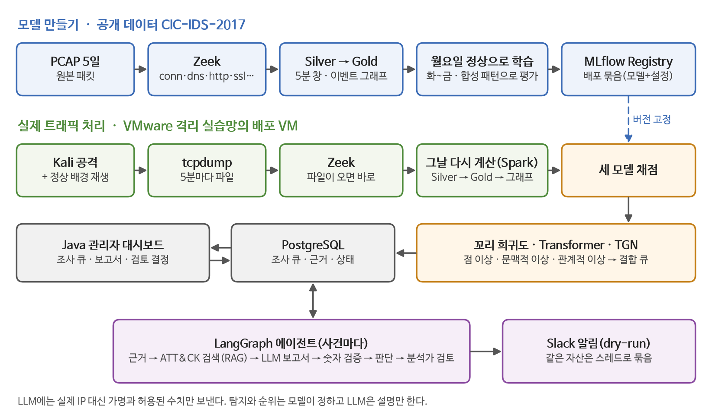
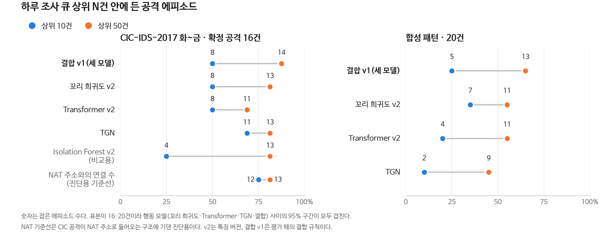
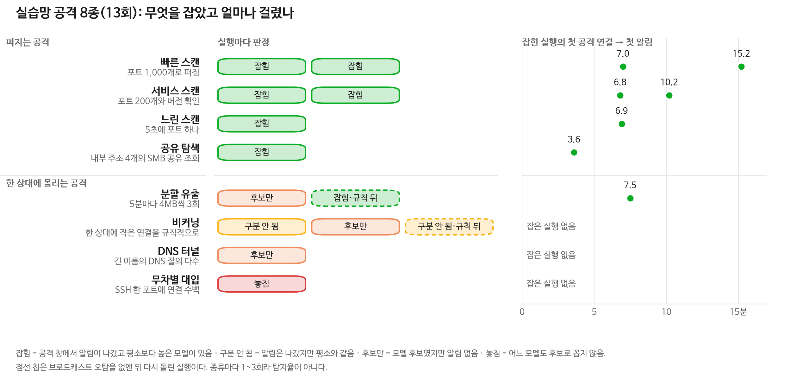

# NBAD: Zeek 로그로 내부 자산의 행동 이상을 찾는 end-to-end 파이프라인

NBAD(Network Behavior Anomaly Detection, 네트워크 행동 이상탐지)는 네트워크 센서 Zeek의 로그만으로 내부 호스트의 평소와 다른 행동을 찾는다. 찾은 행동은 조사 큐에 올리고 근거·LLM 보고서·Slack 알림까지 자동으로 만든다. 공개 데이터(CIC-IDS-2017)로 모델을 만들어 평가한 뒤 격리된 VMware 실습망에서 실제 트래픽(Kali 공격 + 정상 배경)을 흘려 수집부터 알림까지 도는 것을 확인했다.

목적은 성능 수치가 아니다. 실제 트래픽이 들어와 조사 큐와 보고서가 나오기까지의 전 과정을 만들고 단계마다 결과를 재는 것이다.



## 한눈에 보기

| 항⁠목 | 내용 |
| --- | --- |
| 입⁠력 | Zeek 연결 로그(conn)와 프로토콜 로그(dns·http·ssl·ssh·smb 등) |
| 학⁠습 | 라벨 없이 월요일 정상 트래픽만 쓴다 |
| 모⁠델 | 꼬리 희귀도(점 이상), Transformer(문맥적 이상), TGN(관계적 이상). 세 모델의 하루 큐를 순위대로 번갈아 합쳐 조사 큐를 만든다 |
| 출⁠력 | 조사 큐, 사건 근거, LLM 보고서, Slack 알림(dry-run), Java 관리자 대시보드([nbad-dashboard](https://github.com/prosild/nbad-dashboard)) |
| 검⁠증 | CIC-IDS-2017 화\~금 확정 공격 16건, 합성 패턴 20건, 실습망에서 모사한 공격 8종(13회) |
| 운⁠영 | 파일 단위 자동 파이프라인, MLflow Registry 배포 묶음(교체·롤백), 재현 검사, Docker Compose |
| 기⁠술 | Zeek 8, PySpark, PyTorch, PyTorch Geometric, scikit-learn, MLflow, LangGraph, Gemini, PostgreSQL 17 + pgvector, FastAPI, Java(대시보드) |

## 핵심 결과

- 공개 데이터: 결합 큐는 CIC 확정 공격 16건 중 14건을 하루 상위 50 안에 올렸다. 상위 10에서는 NAT 주소와의 연결 수만 세는 자명한 기준선(12/16)이 결합(8/16)보다 높았다.
- 실습망: Kali·대상 VM으로 공격 8종을 13회 발생시켰다. 포트·호스트로 퍼지는 4종(스캔 3종, SMB 공유 탐색)은 첫 연결 뒤 3.6\~15.2분에 알림까지 갔다. 한 상대에 몰리는 4종(비커닝·유출·DNS 터널·무차별 대입)은 처음 돌렸을 때 잡지 못했다.
- 오탐 튜닝: 유휴 상태에서 브로드캐스트 한 건이 5분마다 사건이 되던 것을 조사 큐 자격 규칙으로 없앴다(유휴 3일 271 → 0건). 규칙 뒤에 다시 돌리자 분할 유출도 알림까지 갔다.
- LLM: 보고서의 숫자·자산을 코드로 검증해 평가 30건 중 28건이 통과했다. 공격 문장 16종을 로그 필드·검색 문서·LLM 응답 자리에 넣는 시험(약 1,000개 조합)으로 로그의 문장이 LLM 입력에 닿지 않는 것을 확인했고 응답 쪽에서 찾은 구멍을 막았다.

## 데이터와 정답

CIC-IDS-2017의 CSV flow를 쓰면 라벨이 바로 붙는다. 하지만 CSV를 만든 CICFlowMeter는 데이터셋 제작용 연구 도구이고 TCP 종료 처리 결함과 라벨 오류가 알려져 있다. 관제 현장에서 쓰는 센서는 Zeek라서 PCAP 5일을 Zeek로 다시 처리했다. 모델을 정하기 전에 데이터부터 봤고 본 것을 설계 규칙으로 옮겼다.

| 본 것 | 설계에 반영한 것 |
| --- | --- |
| 공격 대부분이 방화벽 NAT 주소(172.16.0.1)에서 들어온다 | NAT 주소를 공격자로 취급하지 않는다. NAT 주소와의 연결 수를 진단용 기준선으로 두고 모델 점수가 주소 지식에 얼마나 기대는지 잰다 |
| Zeek 기록 시각(`_write_ts`)이 연결 시작 시각과 다르다 | 기록을 쓸 수 있게 된 시각으로 5분 창을 나눠 실시간 운영과 같은 시간 의미를 지킨다 |
| 호스트마다 보내는 쪽·받는 쪽 비중이 크게 다르다 | 자산 × 역할(보내는 쪽·받는 쪽)로 창을 따로 만든다 |
| 바이트 결측과 실제 0바이트가 섞여 있다 | 결측은 합계에서 빼고 결측 비율을 따로 특징으로 둔다 |
| 연결 수·바이트 분포의 꼬리가 길다 | `log1p`로 변환하고 통계는 월요일 학습 구간에서만 적합한다 |
| CSV 라벨에 오류가 있고 단위가 Zeek 연결과 다르다 | 정답을 Zeek 연결 기준으로 다시 만든다 |

정답은 공식 공격 일정에서 후보를 찾고 Zeek 연결에서 공격자·피해자·포트·시각을 확인한 뒤 개선 라벨(CICIDS2017_improved)과 대조해 만들었다. 모델 점수를 보기 전에 동결했고 확정 에피소드는 16건이다. 조건이 주소·포트·시각 수준이라 독립 검증된 정답이라고 부르지 않고 CSV 기반 논문 수치와 비교하지도 않는다.

학습은 월요일(정상)만으로 한다. 앞 80%로 학습하고 뒤 20%는 임계값용 보류 구간으로 둔다. 화\~금은 평가에만 쓴다. 조용하고 오래가는 APT형 행동은 CIC에 적어서 beacon, 느린 유출, DNS 터널, 측면 이동, 느린 정찰 5종을 화\~금 로그 사본에 20건 주입해 따로 평가했다.

## 모델

| 모델 | 보는 이상 | 점수 |
| --- | --- | --- |
| 꼬리 희귀도(통계 기준선) | 점 이상: 창 하나가 정상 분포에서 얼마나 드문가 | 특징별 꼬리 희귀도 중 최댓값 |
| Transformer | 문맥적 이상: 이 자산의 직전 1시간 흐름과 비교해 다른가 | 직전 12개 창으로 다음 창을 예측한 오차(자기지도) |
| TGN(시간 그래프 신경망) | 관계적 이상: 누가 누구와 연결하는가 | IP를 노드, 연결 하나하나를 시각이 붙은 엣지로 두고 연결의 속성을 복원한 오차 |

통계 모델은 창 하나가 정상 분포에서 얼마나 드문지만 본다. 이 데이터의 공격은 직전 흐름과 달라지는 모습(문맥적 이상)과 평소 없던 상대와의 연결(관계적 이상)으로도 드러나서 Transformer와 TGN을 더했다. 두 모델은 PyTorch로 실습 노트북에서 작성해 옮겼다.

세 모델은 점수 척도와 꼬리 모양이 다르다. 정규화해 더하면 Transformer가 하루 상위 창을 거의 독차지해서 점수를 섞지 않고 모델별 하루 큐를 순위대로 번갈아 합쳤다. 그 대가로 상위 10에서는 예산이 세 모델로 나뉘어 단독 최고 모델보다 낮다. 상위 50에서는 가장 높고 모델마다 다른 패턴을 한 큐에 담는다. 지금 배포 중인 결합 v2는 여러 모델이 겹쳐 꼽은 사건을 하나로 합친다.

<details>
<summary>모델을 고르며 확인한 것</summary>

- Transformer는 학습 창이 1,286개뿐이라 같은 데이터로 Ridge 회귀를 따로 재 봤다. 보류 구간 예측 오차가 같은 수준(0.47)이었다. 이 규모에서는 복잡도가 성능으로 이어지지 않았다는 뜻이라 결과에 그대로 적었다.
- TGN은 평가일마다 월요일에 없던 외부 IP가 많이 나타나서 주소 접두사 해시로 노드 특징을 만들었고 NAT 연결을 뺀 점수를 따로 진단했다.
- 손으로 만든 행동 탐지기는 first-seen까지 만들고 fan-out·beaconing은 멈췄다. 이런 휴리스틱은 CIC 숫자를 올릴 수 있지만 목적이 ML·DL 모델로 룰이 놓치는 행동에 대응하는 것이어서 Zeek 프로토콜 로그 특징을 더하고(18개 → 42개) 모델을 다시 학습하는 쪽에 시간을 썼다. NAT 주소와의 연결 수만 진단용 기준선으로 남겼다.
- 코드: [zeek_ad/transformer_model.py](zeek_ad/transformer_model.py), [zeek_ad/tgn_model.py](zeek_ad/tgn_model.py)

</details>

## 평가: 공개 데이터

라벨 없는 운영을 가정해 모델은 공격을 판정하지 않고 사람이 볼 순서를 정한다. 그래서 정확도나 F1 대신 하루 조사 큐 상위 N건 안에 든 공격 에피소드 수(Recall@N)로 평가했다. 채점 단위는 내부 자산 × 역할 × 5분 창이고 이어진 이상 창을 사건 하나로 묶는다.



- 표본이 16·20건이라 행동 모델(꼬리 희귀도·Transformer·TGN·결합) 사이의 95% 구간이 모두 겹친다. 모델 사이의 차이를 확실하다고 말할 수 없다.
- 자명한 기준선이 행동 모델보다 높다. CIC 공격이 NAT 뒤에서 들어오는 데이터 구조 때문이다. TGN의 11/16도 NAT 연결을 빼면 6/16이다.
- 모델마다 잡는 패턴이 다르다. 창 모델(꼬리 희귀도, Transformer)은 느린 정찰을 안정적으로 잡고 TGN은 beacon(5분에 연결 하나)을 창 모델보다 높게 올린다.

<details>
<summary>표와 해석할 때 주의할 점</summary>

모델 이름 뒤 v2는 특징 버전이다(conn 18개 + 프로토콜 로그 24개). 로그 특징은 화\~금 결과를 본 뒤 더해 평가에 노출됐다. 결합 v1은 평가 때의 결합 규칙이고 CIC 숫자는 v1 그대로 둔다. 대괄호 안은 bootstrap 95% 구간이다(Recall@10만).

CIC 화\~금, 확정 정답 에피소드 16건

| 큐 | Recall@10 | Recall@50 |
| --- | --- | --- |
| 꼬리 희귀도 v2 | 8/16 [0.25, 0.75] | 13/16 |
| Transformer v2 | 8/16 [0.25, 0.75] | 11/16 |
| TGN | 11/16 [0.44, 0.94] | 13/16 |
| 결합 v1 | 8/16 [0.25, 0.75] | 14/16 |
| (비교용) Isolation Forest v2 | 4/16 [0.06, 0.44] | 13/16 |
| (진단용 자명한 기준선) NAT 주소와의 연결 수 | 12/16 [0.56, 0.94] | 13/16 |

합성 패턴 20건(CIC 사건과 겹치는 것을 뺀 주 큐)

| 큐 | Recall@10 | Recall@50 |
| --- | --- | --- |
| 꼬리 희귀도 v2 | 7/20 [0.15, 0.55] | 11/20 |
| Transformer v2 | 4/20 [0.05, 0.40] | 11/20 |
| TGN | 2/20 [0.00, 0.25] | 9/20 |
| 결합 v1 | 5/20 [0.10, 0.45] | 13/20 |

- CIC는 공개된 지 오래된 데이터라 설계 단계에서 이미 살펴봤다. 이 결과는 독립 시험이 아니다. 설계 노출을 밝힌 회고적 사례 평가다.
- 맞힘은 사건의 창이 정답 창과 겹치는지로 판정한다. 그래서 공격이 아닌 연결의 점수로 맞힌 경우도 있다(TGN의 Patator 2건은 같은 창의 다른 연결이 점수를 올렸다).
- Recall@N은 상위 N 밖에서 울리는 오탐을 보지 못한다. 정상에서 울리는 빈도는 임계값(정상 보류 구간 점수의 95번째 백분위수)으로 설계상 약 5%에 묶여 있고 운영에서는 분석가 결론으로 알림 정밀도를 집계한다.
- 라벨 없는 운영으로 옮겨지는 것은 Recall 숫자가 아니라 행동 유형별 강약과 정상에서 울리는 빈도다. 임계값은 CIC 월요일 기준이라 새 환경에서는 그곳의 정상 기간으로 다시 잡아야 한다.

</details>

## 실습망 시연

VMware에 배포 VM, Kali, 공격 대상 VM을 두고 배포 VM이 실습망 세그먼트 전체를 보는 센서가 되게 했다(수집 카드를 promiscuous로 둠). 처음 생각한 시놀로지 NAS는 공격 트래픽이 실제 데이터에 닿고 파이프라인 자기 트래픽이 수집에 섞여서 접었다. 실습망에는 평소 트래픽이 없어 CIC 월요일 보류 구간을 실습망 주소로 바꿔 재생한 트래픽과 스크립트로 만든 정상 클라이언트 트래픽을 배경으로 깔았다. 재생·합성·공격은 서로 다른 IP 그룹에 두어 무엇이 꼽혔는지 가를 수 있게 했다. 모델은 실습망 데이터로 다시 학습하지 않았으므로 실습망 점수는 CIC 월요일 기준과의 차이로 읽는다.

공격은 성격이 다른 8종을 1\~3회씩 돌렸다. 스캔·공유 탐색·DNS 터널·무차별 대입은 Kali에서 보냈고 비커닝과 분할 유출은 침해된 대상 VM에서 내보냈다. 공격마다 포트·대상 주소·시간대를 달리 두었다. 시각·주소·포트를 정답으로 적어 두고 파이프라인이 남긴 채점·사건·알림 기록에서 잡았는지와 걸린 시간을 계산했다.



- 잡은 것은 모두 여러 포트나 여러 호스트로 퍼지는 공격이다. 상대 포트 수·상대 수 같은 특징이 학습한 정상과 달랐다. 스캔은 5초에 포트 하나로 늦춰도 Transformer 점수가 18.8로 그 호스트의 공격 없는 창(2.3)과 크게 달랐다. 공유 탐색은 세 모델이 모두 꼽았고 TGN 점수가 평소와 가장 크게 벌어졌다(14.04, 평소 3.99). TGN을 넣은 이유인 관계적 이상(평소 없던 상대와의 연결)에 가장 가까운 공격이다.
- "공격 창에서 모델 후보였다"만으로는 잡았다고 하지 않았다. 대상 VM은 학습 자료에 없던 새 자산이라 공격이 없는 창 54개 가운데 49개에서도 후보였다. 공격 창에서 나온 알림이 있고 그 자산의 평소 창보다 점수가 높은 모델이 있을 때만 "잡힘"으로 셌다. "구분 안 됨"은 알림은 있었지만 평소보다 높은 모델이 없다는 뜻이고 "후보만"은 모델 후보였지만 공격 창에서 나온 알림이 없다는 뜻이다.
- 걸린 시간은 첫 공격 연결부터 첫 알림 기록까지다(Slack은 dry-run이라 기록 시각). 대부분은 5분 창이 닫히기를 기다리는 시간이다. 창이 닫힌 뒤로는 약 2분이다. 배경 트래픽 위에서 돌린 2회차 스캔만 5\~10분이 더 걸렸다.

<details>
<summary>그림의 내용을 표로 보기</summary>

| 공격 | 창에 남는 모양 | 판정 | 첫 알림까지 |
| --- | --- | --- | --- |
| 빠른 스캔(2회) | 포트 1,000개로 퍼짐 | 잡힘, 잡힘 | 7.0분, 15.2분 |
| 서비스 스캔(2회) | 포트 200개와 버전 확인 | 잡힘, 잡힘 | 6.8분, 10.2분 |
| 느린 스캔 | 5초에 포트 하나 | 잡힘 | 6.9분 |
| 공유 탐색 | 한 호스트가 내부 주소 4개의 SMB 공유를 조회 | 잡힘(세 모델 모두) | 3.6분 |
| 비커닝(3회) | 한 상대에 작은 연결을 규칙적으로 | 구분 안 됨, 후보만, 규칙 뒤 구분 안 됨 | 없음 |
| 분할 유출(2회) | 5분마다 4MB씩, 연결 하나로 3회 | 후보만, 규칙 뒤 잡힘 | 규칙 뒤 7.5분 |
| DNS 터널 | 긴 이름의 DNS 질의 다수 | 후보만 | 없음 |
| 무차별 대입 | 한 포트(SSH)에 연결 수백 | 놓침 | 없음 |

"규칙 뒤"는 아래 오탐 튜닝을 배포한 뒤 다시 돌린 실행이다. "구분 안 됨"은 알림이 나갔어도 평소와 같아 탐지 시간으로 세지 않았다.

</details>

<details>
<summary>사건 하나가 지나간 길(첫 실행의 포트 스캔)</summary>

```text
Kali 10.10.0.50 ── nmap -sT -p 1-1000 (03:45 UTC) ──▶ 배포 VM 10.10.0.10
  │
  ▼ tcpdump(5분 경계마다 파일) → Zeek → 그날 다시 계산(Silver → Gold 5분 창)
  │
  ▼ 창 하나: 배포 VM · 받는 쪽 · 03:45~03:50
  │     꼬리 희귀도    7.16  (임계값 5.55)  → 후보
  │     Transformer   16.58  (임계값 1.26)  → 후보
  │     TGN            4.92  (임계값 9.90)  → 아님 (다음 칸 nmap -sV 03:50은 11.74로 후보)
  │
  ▼ 이어진 후보 창을 사건 하나로: 배포 VM 받는 쪽 03:45~03:55, 연결 1,169
  │
  ▼ 결합 큐 2위 (1위는 같은 공격의 Kali 보내는 쪽 사건)
  │
  ▼ LangGraph 에이전트
  │     정책 규칙: 보냄 → 템플릿 알림을 먼저 기록
  │     근거 사실(실제 IP 대신 가명) → ATT&CK 검색 → LLM 보고서 → 숫자·자산 검증 통과
  │       보고서 숫자 예: "1000개 고유 목적지 포트, 1000건 중 999건 REJ"
  │     판단 모델: send
  │
  ▼ Slack(dry-run 기록) · PostgreSQL → 근거 API · Java 대시보드
```

첫 시연에서 함께 잰 것

공격은 Kali에서 5분 칸마다 하나씩 실행했다(ping, `nmap -sT` 1,000포트, `nmap -sV`). 배경은 35분짜리였다.

1. VM에서 실시간으로 도는 처리(수집 → Zeek → 다시 계산 → 세 모델)는 같은 정상 트래픽(CIC 월요일 보류 35분 재생)에 배치와 비슷한 점수를 낸다. 창 단위 순위 상관은 0.70\~0.83이다. 꼬리 희귀도는 이상 판정 비율까지 같다(6%).
2. Transformer는 자산 이력이 없는 첫 창에서, TGN은 새 노드 문맥에서 이상 판정이 는다.
3. 포트 스캔(`nmap -sT` 1,000포트, `-sV`)은 정상 배경이 있든 없든 꼬리 희귀도·Transformer가 매번 잡았다. ping은 Kali 쪽에서 두 모델 모두 잡지 않았다. 사건 보고서의 숫자(포트 수, 거부 수)는 관측과 맞았다.
4. TGN은 스캔당하는 서버와 통신한 정상 클라이언트를 스캔하는 칸에서만 함께 꼽았다(앞뒤 배경 칸에서는 0). 그래프 이웃 전파의 효과이자 한계다.
5. 결합 큐는 조사 순서이지 판정이 아니다. 배경을 섞은 실행에서 큐 1위는 월요일에도 드물었던 정상 창이었고 공격 사건은 6·7위였다.

</details>

<details>
<summary>놓친 공격은 왜 놓쳤나</summary>

규칙 전의 기록에서 알림으로 이어지지 않은 넷은 이유가 다르다.

- 비커닝과 유출은 대상 VM에서 시작했다. 이 자산은 공격이 없어도 거의 모든 창에서 후보라 공격 창의 점수가 평소보다 높지 않았다. 공격 창도 대부분 공격 전부터 이어지던 사건에 붙었고 이미 알린 사건은 다시 알리지 않으므로 새 알림 없이 지나갔다.
- 무차별 대입은 연결 수(300)가 월요일 정상 범위 안이었다(창당 연결 수 p99가 2,000이 넘는다). 시험이 실제 비밀번호를 넣지 않아 SSH 인증 실패 특징도 0이었다.
- DNS 터널은 질의 수·이름 길이·엔트로피가 모두 계산됐지만(각각 142·55·4.44) DNS가 흔한 정상이라 그 정도로는 드물지 않았다.
- 무차별 대입과 DNS 터널은 특징이 없어서가 아니라 공격이 정상과 구별될 만큼 두드러지지 않았거나 시험이 그만큼 공격적이지 않았던 것이다. 비커닝만 해당 특징(시간 간격의 규칙성)이 아예 없고 양도 작다.

그래서 개선은 경우마다 다르다. 비커닝은 주기성 특징을 더하는 일이고 DNS 터널·무차별 대입은 강도를 높인 시험으로 재확인하거나 그 특징의 정상 분포를 다시 보는 일이다.

</details>

### 오탐 튜닝: 브로드캐스트 한 건이 5분마다 사건이 되던 것

대상 VM은 아무것도 시키지 않아도 Samba가 5분쯤마다 NetBIOS 알림을 실습망 전체(`10.10.0.255:138/udp`)에 뿌린다. 브로드캐스트 주소는 채점 자산이 아니지만 그리로 보낸 연결은 보낸 쪽의 창 특징에 남았고 그 창이 "드문 창"으로 꼽혔다. CIC 월요일의 보낸 쪽 창 1,227개 가운데 브로드캐스트·멀티캐스트행 연결만 있는 창은 하나도 없다. 학습 자료의 호스트는 쉬지 않아서 모델은 조용한 호스트의 창을 본 적이 없었다.

모델과 특징은 그대로 두고 조사 큐에 오를 자격만 정했다. 자산이 그 창에 건 연결이 전부 호스트가 아닌 주소로 갔고 그 수가 25개 이하(월요일 정상 창에서 본 최대)이면 점수는 남기되 큐에 올리지 않는다.

| 사건 수(저장된 점수로 큐를 다시 만듦) | 규칙 전 | 규칙 뒤 |
| --- | ---: | ---: |
| 유휴 3일의 사건 | 271 | 0 |
| 공격한 날의 사건 | 88 | 21 |
| 사라진 공격 사건 | | 0 |

규칙 뒤에는 대상 VM의 상시 사건에 묻혀 있던 비커닝과 분할 유출이 따로 사건이 되어 7분대에 알림이 나갔다. 분할 유출은 정상 배경 창보다 점수가 높아 "잡힘"이 됐고(차이는 작고 실행은 한 번이다) 비커닝은 점수가 정상 배경 창과 같아 여전히 구분되지 않는다.

<details>
<summary>다른 방식 대신 큐 자격 규칙을 고른 이유와 대가</summary>

- 유휴 3일의 사건 271건이 전부, 공격한 날은 88건 중 67건이 브로드캐스트행 연결만 있는 창의 사건이었다. LLM 보고서도 같은 비율로 나갔다.
- 특징에서 그 연결을 빼면 깔끔하지만 학습과 운영의 특징 정의가 달라진다. 분석가 예외 규칙은 대시보드와의 계약이 든다. 그래서 모델과 특징을 건드리지 않는 큐 자격 규칙을 골랐다.
- 포트나 프로토콜 이름이 아니라 주소 종류로 가르므로 탐지기를 더한 것이 아니다.
- 수와 무관하게 빼면 브로드캐스트만 쏟아내는 폭주까지 가려지기 때문에 상한을 뒀다. 대가로 창당 25개 이하의 브로드캐스트만 쓰는 활동은 사건이 되지 않는다.
- 규칙 없이 만든 큐가 DB의 사건과 같은 것을 먼저 확인한 뒤 위 수치를 쟀다. 배포 VM에서도 유휴 30분 동안 사건과 LLM 호출이 0건이었다.

</details>

## LLM 에이전트

LLM 보고서는 분석가가 읽기 편하지만 숫자를 틀리거나 지어낼 수 있고 실제 IP를 외부 API로 보내게 된다. 그래서 탐지와 순위는 모델이 정하고 LLM은 설명만 맡겼다.

- LLM에는 허용 목록의 수치와 가명(H·I\*·X\*)만 보내고 실제 IP와 날짜는 보내지 않는다. MLflow trace에도 실제 IP를 남기지 않는다.
- 보고서의 주장마다 근거 사실 번호를 달게 하고 숫자·자산·ATT&CK ID를 코드로 검증한다. 실패하면 템플릿 보고서로 대신한다(평가 30건 중 LLM 28, 템플릿 2).
- ATT&CK 문서를 pgvector에 넣고 Gemini 임베딩으로 검색한다. 같은 질의 16개로 비교했을 때 hit@5가 0.938로 BM25(0.750)보다 높아 이 방식을 골랐다. LLM에는 검색된 기법의 ID·이름·전술만 후보로 넘긴다.
- 로그의 문장이 LLM에 지시로 읽히는 간접 프롬프트 인젝션은 구조로 막는다. 도메인·URI·사용자 이름 같은 자유 문자열은 LLM 입력에 넣지 않는다. 공격 문장 16종을 로그 필드·검색 문서·LLM 응답 자리에 넣어 보는 시험(약 1,000개 조합)으로 이를 고정했고 시험이 찾은 구멍(LLM 응답이 보고서 버전을 덮어쓸 수 있던 것, 제어 문자·URL·긴 문장이 화면으로 가던 것)은 응답 검사에서 막았다. 문장의 뜻은 판별하지 않는다. 알림은 정책 규칙이 정한다.
- Slack 전송 여부를 판단 모델(Gemini)에 맡기기 전에 그림자로 비교했다. 알림은 29 → 16건으로 줄었지만 공격 관련 사건 11건을 바로 보내지 않았다(대부분 분석가 검토로 돌림). 알림 수보다 공격 관련 사건을 바로 알리는 쪽이 중요해서 전송은 정책 규칙에 맡겼다.

<details>
<summary>알림 흐름과 분석가 검토</summary>

- 알림은 LLM 보고서(건당 약 30초)를 기다리지 않고 템플릿 보고서로 먼저 보낸다.
- LangGraph 흐름은 분석가 검토에서 멈춘다(interrupt). 대시보드가 DB 함수로 결정을 넣으면 파이프라인이 흐름을 재개해 사건 상태를 바꾸고 후속 알림을 남긴다.
- 같은 자산의 미해결 알림이 60분 안에 있으면 Slack 스레드로 묶는다.
- 공격이 몰려 사건이 한꺼번에 늘면 사건마다 LLM을 부르는 에이전트가 직렬로 처리하느라 뒤 창의 채점까지 밀렸다. 채점을 알림·보고서와 떼어 둘 근거다.

</details>

## 운영과 MLOps

라벨이 없는 운영에서는 계산이 달라져도 알아챌 방법이 없다. 그래서 평가한 계산을 운영에서 그대로 쓰게 묶었다.

- 같은 배치 스크립트로 그날을 다시 계산한다. 정식 Spark Structured Streaming 대신 파일 단위 마이크로배치다.
- 배포 묶음 = 세 모델 + 전처리 + 특징 스키마 + 임계값 + 사건·결합 정책 + 코드 해시. MLflow Registry 버전으로 등록하고 코드가 다르면 채점을 거부한다.
- 등록 전에 CIC 5일 창 점수가 원래 평가와 같은지 재현 검사를 한다(차이 0).
- 채점 작업은 시작할 때 버전을 번호로 고정한다. 교체 → 롤백 → 재교체를 실제 추론으로 확인했다.
- worker 장애 복구 시험(쓰기 중·commit 전후 강제 종료) 9/9 통과. 처리 중 끊긴 파일은 이어서 처리하고 오래된 리비전은 자동으로 정리한다.

## 한계

- CIC 평가는 16·20건이라 모델 차이를 통계적으로 가를 수 없다. 자명한 NAT 기준선이 행동 모델보다 높다.
- 정상 기준선은 CIC 월요일 하루(창 1,286개)다. 실습망 호스트는 학습 이력이 없는 새 자산이라 정상 활동도 후보가 되고 브로드캐스트 오탐을 없앤 뒤에도 정상 배경 창이 알림까지 갔다. 실습망 정상 트래픽으로 다시 학습하지 않았다. 생성기로 만든 트래픽으로 학습하면 실제 행동이 아니라 생성기의 모양을 배우기 때문이다.
- 실습망 공격은 종류마다 1\~3회라 "8종 중 몇 종"은 탐지율이 아니다. 벤치마크가 아니라 무엇을 왜 못 보는지 실제 트래픽으로 확인하는 정성적 프로브다. 비커닝은 알림이 나가도 평소와 구분되지 않았고(시간 간격의 규칙성 특징이 아예 없다) DNS 터널·무차별 대입은 알림까지 가지 못했다. 실습망 호스트는 견줄 평소 창도 적다.
- TGN은 연결 점수를 양쪽 자산의 창에 준다. 그래서 공격당한 서버와 통신한 정상 호스트가 공격 창에서 함께 꼽힌다. 한쪽에만 주는 규칙은 CIC 확정 공격 16건 중 11건(NAT 뒤 외부 공격, 피해 서버 쪽으로만 보임)의 신호를 없앨 수 있어 평가 없이 넣지 않았다.
- 결합 v2는 겹친 사건을 합치기 때문에 공격 사건에 정상 배경 창이 붙을 수 있다.
- 관제 경험자 라벨이 없다. 경험 없이 단 라벨은 관제 판단을 대표하지 못해 전송 판단은 정답 에피소드 기준으로만 비교했다.
- 가명과 실제 IP의 매핑은 사건 근거와 같은 DB에 기한 없이 남는다(LangGraph checkpoint, Slack 기록 포함). 밖으로는 가명만 나간다. 보관 기간과 삭제는 구현하지 않았다.
- 하지 않은 것: Slack 실제 전송(지금은 dry-run), 판단 모델로의 전환, 드리프트 감시, 새 환경 임계값 재설정.
- LLM 보고서 문장에 내부 사실 이름(`baseline_windows` 등)이 나온다. 고치는 프롬프트 후보를 만들었지만 API 한도로 평가 30건 확인을 마치지 못해 적용하지 않았다.

## 실행 방법

```bash
conda env create -f environment.yml && conda activate zeek-ad
python3 scripts/check_inputs.py                 # 원본 입력 경로·크기 확인(내용은 읽거나 바꾸지 않음)
python -m unittest discover -s tests            # 시험 334개(DB·LLM·네트워크 없이 몇 초)
python scripts/make_env.py                      # deploy/.env를 무작위 비밀번호로 만든다(Gemini 키는 직접 넣는다)
docker compose -f deploy/compose.yaml --env-file deploy/.env up -d && python scripts/db_migrate.py
```

- 배포 VM과 Kali 실습망을 처음부터 만드는 순서는 [docs/vm-deployment.md](docs/vm-deployment.md), 자동 파이프라인은 [docs/live-pipeline.md](docs/live-pipeline.md)에 있다.
- 원본 데이터(약 51GB)와 생성물(`outputs/`)은 저장소에 없다.

<details>
<summary>저장소 구조</summary>

| 폴더 | 내용 |
| --- | --- |
| [zeek_ad/](zeek_ad/) | 라이브러리: 창·사건, 특징, 모델(기준선·Transformer·TGN), 결합, 배포 묶음, worker, 근거, LLM 입력·보고서·검증, RAG, LangGraph, Slack, 수집·리비전 |
| [scripts/](scripts/) | 실행 스크립트: Zeek, Silver·Gold, 학습·평가, 묶음 등록, 실시간 처리, API, README 그림 |
| [configs/](configs/) | 고정한 설정(자산 대역, 창, 모델, 결합 v1·v2, 에이전트·프롬프트, RAG, 파이프라인, 정답) |
| [db/migrations/](db/migrations/) | PostgreSQL 스키마(001\~019): 채점 결과, 근거, 대시보드 뷰, 사건 상태, 검토 결정·재개 함수, 분석가 결론 집계 |
| [deploy/](deploy/) | Docker Compose(DB·MLflow·API·파이프라인·수집기), 이미지, 묶음 내보내기·가져오기 |
| [tests/](tests/) | 단위 시험(창·사건, 결합, 수집·리비전, 보고서 검증, 인젝션, 그래프 재개, Slack 등) |
| [docs/](docs/) | 설계 결정, 진행 기록, 데이터 계약, 배포 안내 |

프로젝트의 처음 이름은 `zeek_AD`였다. Python 패키지(`zeek_ad`), conda 환경(`zeek-ad`), DB 이름(`zeekad`), 설치 경로(`~/zeek_AD`)는 이미 검증한 것을 다시 검증하지 않으려고 바꾸지 않았다. 운영 문서와 작업 기록에도 `zeek_AD`가 그대로 나온다.

</details>

## 더 읽을 문서

- [docs/portfolio-summary.md](docs/portfolio-summary.md): 한 장 요약.
- [docs/design-decisions/](docs/design-decisions/): 설계를 바꾼 결정 22건. 결정마다 배경, 결정, 확인한 것, 한계를 적었다.
- [docs/design-discussion-log.md](docs/design-discussion-log.md): 설계 질문·이의와 판단 근거 90여 건. 설계를 바꾸지 않은 경우도 적었다.
- [docs/stage-0-progress.md](docs/stage-0-progress.md) \~ [docs/stage-7-progress.md](docs/stage-7-progress.md): 단계별로 한 일, 실행 결과, 발견한 문제.
- [docs/ground-truth-v1.md](docs/ground-truth-v1.md): CIC 정답 에피소드를 만든 방법과 출처 사이의 불일치.
- [docs/eda-design-evidence.md](docs/eda-design-evidence.md): EDA 측정과 그림.
- [docs/lab-attack-detection.md](docs/lab-attack-detection.md): 실습망 공격 8종의 판정 기준과 당사자별 값. 정답은 [configs/ground-truth/lab-attacks.v1.json](configs/ground-truth/lab-attacks.v1.json).
- [docs/design-decisions/DD-021-queue-eligibility-non-host-only.md](docs/design-decisions/DD-021-queue-eligibility-non-host-only.md): 브로드캐스트 오탐을 없앤 조사 큐 자격 규칙.
- [docs/llm-injection-tests.md](docs/llm-injection-tests.md): 간접 프롬프트 인젝션 시험에서 넣어 본 것과 막힌 곳.
- [docs/data-contract-v2.md](docs/data-contract-v2.md): Java 대시보드([nbad-dashboard](https://github.com/prosild/nbad-dashboard))와의 데이터 계약.
- [docs/README.md](docs/README.md), [scripts/README.md](scripts/README.md): 문서·스크립트 전체 안내.

개발에는 AI 코딩 도구를 함께 썼다. 설계를 바꿀 때마다 결정 문서를 남기고 결과는 시험과 실제 실행으로 확인했다.

데이터: CIC-IDS-2017(Canadian Institute for Cybersecurity, UNB; Sharafaldin 외, ICISSP 2018), 개선 라벨 CICIDS2017_improved(Engelen 외 2021, Liu 외 2022). 이용 조건은 [docs/data-usage-terms.md](docs/data-usage-terms.md)에 있다.
