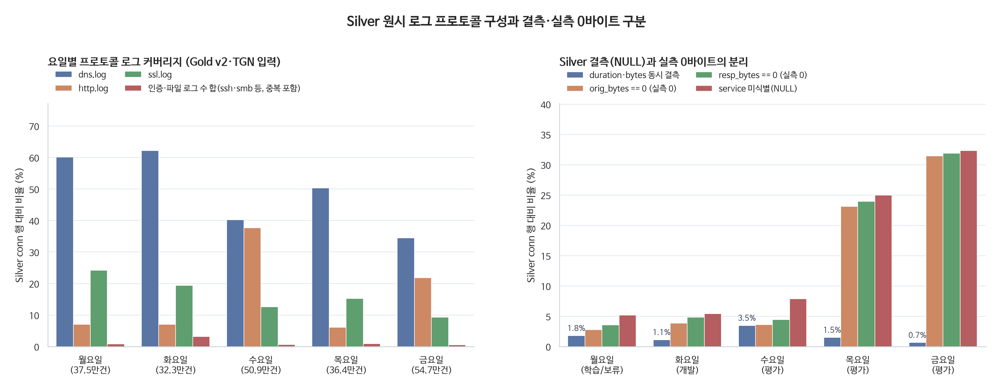
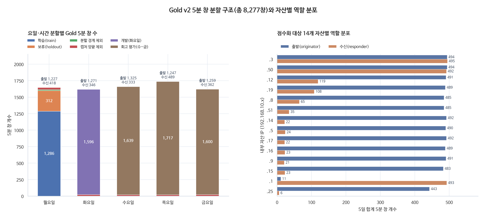
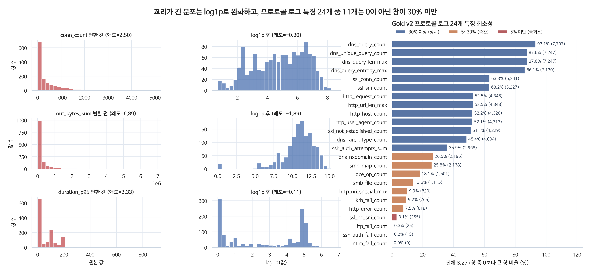
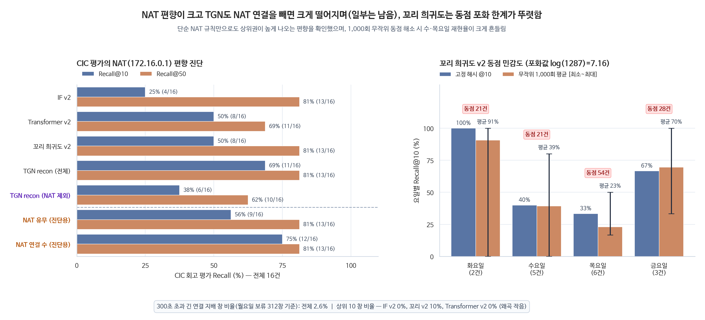
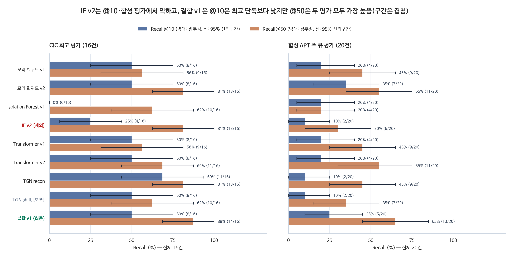
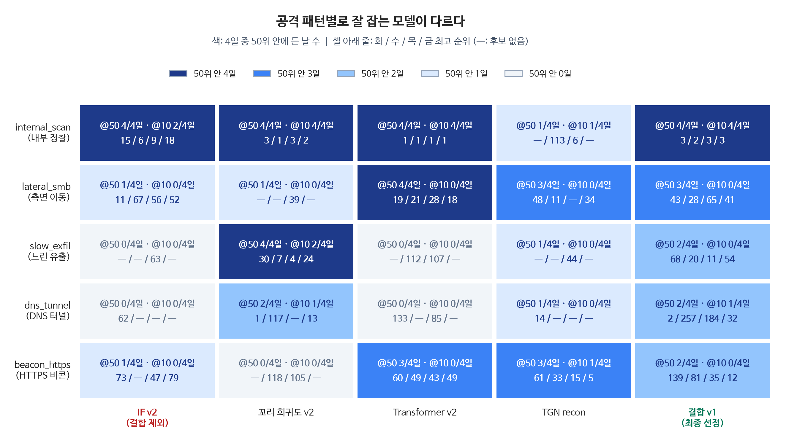

# EDA 결과 및 설계 근거 정리

이 문서는 Zeek `conn.log` 기반 내부 자산 이상 탐지 파이프라인에서 **데이터 계층화(Bronze/Silver/Gold), 창 분할, 특징 변환, 진단 기준, 최종 결합 모델(`fusion.v1`) 선정**에 사용한 탐색적 데이터 분석(EDA)과 실험 근거를 정리한다. 모든 수치와 차트는 읽기 전용 산출물에서 재계산해 생성했다.

- 생성 스크립트: [build_eda_part1.py](../scripts/build_eda_part1.py), [build_eda_part2.py](../scripts/build_eda_part2.py), [eda_plots.py](../zeek_ad/eda_plots.py)
- 기계 판독 통계(SHA-256 계보 포함): [part1_stats.json](figures/eda/part1_stats.json), [part2_stats.json](figures/eda/part2_stats.json)
- 그림·통계 파일은 생성 스크립트가 `outputs/eda/`에 쓴 것을 저장소용으로 복사한 것이다(`docs/figures/eda/`, 2026-11-19). 다시 만들면 다시 복사한다.

## 읽는 법: EDA를 한 시점과 이 그림을 만든 시점

EDA는 설계와 구현을 하면서 진행했다. 설계를 확정하기 전(2026-11-03)에 5일 PCAP을 Zeek로 처리해 다음을 쟀다.
- NAT 주소 172.16.0.1의 활동
- `_write_ts` 기준 5분 창 수와 학습·보류 분할
- 역할(보내는 쪽·받는 쪽)별 창 수
- 정답과 Zeek 연결의 대응
- 통계 기준선의 동률

이 측정이 [최종 설계](../FINAL_PROJECT_DESIGN.md)의 규칙이 됐다. 역할 분리, `_write_ts` 창, NAT 주소를 채점하지 않는 규칙, `log1p` 기본 변환, Zeek 연결 기준의 정답 재구성이 그렇다. 근거는 [설계 확정 전 검증 결과](../final-design-verification-results.md)에 있다. 구현 중에도 데이터를 보고 정한 것이 있다. 결측과 실제 0바이트의 분리(단계 2)와 TGN 수치 표준편차 하한(단계 3, TGN 평가 전)이다.

당시 측정값은 설계 문서와 진행 기록에 흩어져 있었고 그림이 없었다. 이 문서의 그림과 표는 2026-11-13에 저장된 산출물로 다시 계산해 한곳에 모은 것이다. 그래서 그림을 만든 날짜가 결정보다 늦다.

화~금 평가 결과를 본 뒤 정한 결정도 있다. 로그 특징 추가(Gold v2, DD-006 수정 절)와 결합 구성(결합 v1, DD-009)이다. 이 둘은 평가 노출로 표시한다. TGN은 관계적 이상을 보려고 넣은 모델이고(DD-007) 데이터는 세부 처리(처음 보는 IP, 표준편차 하한)를 정하는 데 쓰였다. 아래 각 절의 "관련 결정과 데이터"에 어느 쪽인지 적었다.

---

## 1. Silver 정제 근거: 프로토콜 로그 커버리지와 결측·0바이트 분리



### 관찰 사실 (`CIC-IDS-2017` 5일, 총 2,119,277행)

| 요일 | Silver `conn` 행 | `duration·bytes` 동시 결측(행 / %) | `orig_bytes == 0` | `resp_bytes == 0` | `service` NULL | `dns.log` | `http.log` | `ssl.log` |
| --- | ---: | ---: | ---: | ---: | ---: | ---: | ---: | ---: |
| 월(`cic17-mon`) | 375,432 | 6,724 (1.8%) | 10,523 (2.8%) | 13,312 (3.5%) | 19,475 (5.2%) | 225,855 (60.2%) | 26,279 (7.0%) | 90,824 (24.2%) |
| 화(`cic17-tue`) | 323,342 | 3,624 (1.1%) | 12,422 (3.8%) | 15,575 (4.8%) | 17,592 (5.4%) | 201,163 (62.2%) | 22,806 (7.1%) | 62,637 (19.4%) |
| 수(`cic17-wed`) | 509,362 | 17,744 (3.5%) | 18,382 (3.6%) | 22,672 (4.5%) | 40,153 (7.9%) | 204,675 (40.2%) | 192,066 (37.7%) | 64,333 (12.6%) |
| 목(`cic17-thu`) | 363,788 | 5,471 (1.5%) | 84,191 (23.1%) | 87,050 (23.9%) | 90,929 (25.0%) | 183,041 (50.3%) | 22,200 (6.1%) | 55,578 (15.3%) |
| 금(`cic17-fri`) | 547,353 | 3,558 (0.7%) | 172,034 (31.4%) | 174,452 (31.9%) | 177,065 (32.3%) | 188,870 (34.5%) | 119,483 (21.8%) | 51,120 (9.3%) |

### 관련 결정과 데이터
1. **결측(NULL)과 실측 `0`바이트의 분리**([feature-dictionary-v1.md](feature-dictionary-v1.md), 단계 2): 5일 전체에서 `duration`, `orig_bytes`, `resp_bytes`는 항상 함께 비어 있거나 함께 존재했다(합계 37,121행, `duration == 0`은 0행). 반면 바이트 `0`은 실제로 0바이트를 주고받은 정상/스캔 연결(금요일 약 31%)이다. 두 의미를 섞지 않고 [conn_features_v1](feature-dictionary-v1.md)에서 결측 연결은 합계·분위수에서 제외하고 `duration_missing_ratio` 특징을 별도로 두었다.
2. **프로토콜 로그 활용(`TGN`, `Gold v2`)**: 연결의 34~62%에 DNS 로그가, 수요일·금요일에는 22~38%에 HTTP 로그가 붙으며 인증·파일 로그(`ssh`, `ftp`, `smb`, `krb`, `dce`, `ntlm`)도 별도 로그에 존재한다. 실제 결정 근거: TGN은 관계적 이상을 보려고 넣은 모델이고([DD-007](design-decisions/DD-007-tgn-event-graph.md)), Gold v2는 TGN만 로그를 보는 상태를 고쳐 창 모델도 같은 로그 정보를 쓰게 한 결정이다(설계 질문 기록 Q33). 결과로 보면 `conn.log` 통계(`Gold v1`)만 쓴 모델들은 화요일 FTP/SSH Patator를 모두 놓쳤다.

---

## 2. Gold v2 창 분할(8,277창)과 자산·역할(originator/responder) 분리



### 관찰 사실
- **시간 분할 분포(총 8,277개 5분 창)**:
  - 월요일(`cic17-mon`): `train` 1,286창(`originator` 958 + `responder` 328), `holdout` 312창(`235 + 77`), `split_boundary` 16창(`12 + 4`), `capture_edge` 31창(`22 + 9`).
  - 화요일(`cic17-tue`): `development` 1,596창(`1,255 + 341`), `capture_edge` 21창(`16 + 5`).
  - 수요일(`cic17-wed`): `retrospective_eval` 1,639창(`1,310 + 329`), `capture_edge` 19창(`15 + 4`).
  - 목요일(`cic17-thu`): `retrospective_eval` 1,717창(`1,233 + 484`), `capture_edge` 19창(`14 + 5`).
  - 금요일(`cic17-fri`): `retrospective_eval` 1,600창(`1,246 + 354`), `capture_edge` 21창(`13 + 8`).
- **점수 대상 14개 자산(`192.168.10.x`)의 역할 비대칭**:
  - `.3`(DNS 등 서버, 출발 494 / 수신 495)과 `.50`(출발 494 / 수신 492)은 양방향 창이 거의 균등하다.
  - `.1`은 출발 11창 vs 수신 493창으로 수신 비중이 절대적이다. 받는 연결은 거의 모두 `.3`이 보내는 DNS(udp/53)다(월요일 수신 75,193건 중 75,191건). 기기 종류는 확인하지 않았다.
  - 일반 워크스테이션(`.14`, `.17`, `.5`, `.9`, `.16`, `.15` 등)은 출발 483~492창 vs 수신 21~24창으로 출발 비중이 압도적이다.

### 관련 결정과 데이터
1. **시계열 누수 차단**([configs/time-windows.v1.json](../configs/time-windows.v1.json), 평가 전 고정): 정상 트래픽만 있는 월요일에서 80% 시간 지점(`split_boundary` 16창)과 캡처 시작·끝 불완전 창(`capture_edge` 111창)을 학습/보류·평가에서 배제해 경계 불완전 창이 임계값이나 점수에 섞이지 않도록 했다.
2. **역할 분리와 IP 처리**: 클라이언트 호스트와 서버는 5분 창 생성 빈도와 방향성이 완전히 다르다. 출발(`originator`)·수신(`responder`) 관점을 별도 행으로 펼쳤다(`out_*`/`in_*` 방향 일치, 설계 3.2절). 창 모델(꼬리 희귀도·IF·Transformer) 입력에는 IP가 없고 `role` 범주만 있다. TGN은 IP 옥텟 접두사 해시 16차원을 노드 특징으로 쓴다([DD-007](design-decisions/DD-007-tgn-event-graph.md), 처음 보는 IP 대응). 그래서 TGN은 처음 보는 주소에 민감할 수 있고, 4절의 NAT 제외 진단으로 따로 본다.

---

## 3. 분포 왜도(`log1p`), 로그 특징 희소성, 수치 표준화 하한



### 관찰 사실
- **월요일 `train` 주요 연속 특징의 극단 왜도 완화**:
  - `conn_count`(`n=1,286`, 중앙값 `144.5`, p99 `2,194.5`, 최댓값 `4,999`): 왜도 `2.505` → `log1p` 후 `-0.300`.
  - `out_bytes_sum`(`n=1,285`, 중앙값 `66,452`, p99 `1,441,316.5`, 최댓값 `6,837,748`): 왜도 `6.895` → `log1p` 후 `-1.890`.
  - `duration_p95`(`n=1,285`, 중앙값 `23.54s`, p99 `314.24s`, 최댓값 `893.48s`): 왜도 `3.327` → `log1p` 후 `-0.108`.
- **Gold v2 24개 프로토콜 특징의 비영(non-zero) 창 비율(전체 8,277창 기준)**:
  - 상시(`30% 이상`): `dns_query_count` `93.1%`(7,707창) ~ `ssh_auth_attempts_sum` `35.9%`(2,968창).
  - 중간(`5~30%`): `dns_nxdomain_count` `26.5%`(2,195창) ~ `http_error_count` `7.5%`(618창).
  - 극희소(`5% 미만`): `ssl_no_sni_count` `3.1%`(255창), `ftp_fail_count` `0.3%`(25창), `ssh_auth_fail_count` `0.2%`(15창), `ntlm_fail_count` `0.0%`(0창).

### 관련 결정과 데이터
1. **`log1p` + `train` 중앙값 대치**: 바이트·연결 수·지속시간은 우측 꼬리가 길어 원시 값으로는 거리·오차 기반 모델(IF·Transformer·TGN)이 극단값에 치우친다. 꼬리 희귀도는 순위(경험분포) 기반이라 원시 값을 그대로 쓴다. 비율을 제외한 수량·합계 특징에 `log1p`를 적용했고, Gold 파일에는 원본 값을 보존한 뒤 전처리기(`Preprocessor`)가 월요일 `train`에서만 통계량을 적합하도록 분리했다.
2. **Gold v2 특징을 비율 대신 개수·최댓값으로 정의([feature-dictionary-v2.md](feature-dictionary-v2.md))**: `ftp`, `ssh`, `krb`, `ntlm` 실패 특징은 대부분 창에서 0건이므로 비율 계산 시 분모 0 문제가 잦다. 따라서 로그가 없으면 0을 갖는 개수·최댓값으로 정의했다.
3. **바이트 값 주의(단계 4에서 발견)**: Zeek `orig_bytes`·`resp_bytes`는 TCP 시퀀스 번호로 계산해 비정상 종료 연결에서 크게 부풀 수 있다. 수요일 DoS 사건 창에서는 724개 연결이 그랬고 합계가 1.06TB로 나왔지만 실제 관측 IP 바이트(`orig_ip_bytes`) 합은 124MB다. 위 `out_bytes_sum` 분포와 모델 입력도 이 값을 쓴다. 동결한 모델이라 바꾸지 않고 한계로 둔다([stage-4-progress.md](stage-4-progress.md) 다섯 번째 작업).
4. **TGN `numeric_std_floor = 1.0`([stage-3-progress.md](stage-3-progress.md))**: 이벤트 단위 TGN 입력에서는 극희소 프로토콜 수치의 `train` 표준편차가 `0.005~0.05` 수준으로 작아, 1회만 관측되어도 표준화 값이 최대 `158`(보류 `recon p95=290`)까지 튀었다. `std < 1.0`인 열은 `1.0`으로 나누도록 하한을 두어 최대 절댓값을 `14` 수준으로 억제했다. 반면 5분 창 집계인 `Gold v2` 기반 Transformer v2는 `|z|` 최대가 `19` 수준이라 별도 하한 없이 안정적으로 학습됐다.

---

## 4. 평가 신뢰성 진단: NAT 편향, 동점 포화, 긴 연결 왜곡



### 관찰 사실
- **CIC `172.16.0.1`(공격망 NAT) 편향([part2_stats.json](figures/eda/part2_stats.json))**:
  - 주소 지식만 쓰는 `NAT 유무(진단용)`이 `@10 9/16(56%)`, `NAT 연결 수(진단용)`이 `@10 12/16(75%)`, 두 기준선 모두 `@50 13/16(81%)`을 맞혔다.
  - `TGN recon`은 전체 `11/16(69%)` → NAT 연결을 창 집계에서 빼면(`NAT 제외`) `@10 6/16(38%)`, `@50 10/16(62%)`로 하락하지만 완전히 0이 되지는 않는다. 또한 정답 창 밖 NAT 연결(3,194개) `recon` 중앙값은 `1.59`, 정답 창 안 NAT 연결은 `4.92`, 비NAT 연결은 `0.09`로 공격 연결이 더 높은 점수를 받았다.
- **꼬리 희귀도 v2 경계 동점 민감도(포화값 `log(1287)=7.16`, 1,000회 무작위 동점 해소)**:
  - 화(`tie=21`): 고정 `100%`, 평균 `90.7%` [`0% ~ 100%`]
  - 수(`tie=21`): 고정 `40%`, 평균 `39.3%` [`0% ~ 80%`]
  - 목(`tie=54`): 고정 `33.3%`, 평균 `23.0%` [`16.7% ~ 50.0%`]
  - 금(`tie=28`): 고정 `66.7%`, 평균 `69.6%` [`33.3% ~ 100%`]
- **긴 연결(>300초) 왜곡 점검(월요일 `holdout` 312창 기준)**:
  - 긴 연결 지배 창은 전체의 `2.6%`(0.0256).
  - 상위 10개 창 중 긴 연결 지배 창 비율: `IF v2 0%`, `꼬리 희귀도 v2 10%`, `Transformer v2 0%`(상위 20 기준 `0%`, `5%`, `5%`).

### 관련 결정과 데이터
1. **합성 APT 평가**([DD-008](design-decisions/DD-008-synthetic-apt-injection.md)): 실제 근거는 "CIC 공격은 대부분 시끄러운 스크립트 공격이라 APT처럼 조용하고 오래가는 행동이 적다"였다. 5종 패턴(`internal_scan`, `lateral_smb`, `slow_exfil`, `dns_tunnel`, `beacon_https` × 4일 = 20건)은 공격 호스트가 내부 자산이라 NAT 주소와 무관하다. 그래서 위 NAT 편향과 따로 볼 수 있는 평가축도 된다.
2. **꼬리 희귀도의 동점 포화**: `train` 범위를 넘는 값이 모두 최대 점수 `log(1287)=7.16`으로 포화되어 경계 동점이 21~54건까지 쌓였고, 목요일 기준 무작위 동점 해소 시 `16.7%~50%`로 흔들렸다. 그래서 꼬리 희귀도의 @10은 고정 해시 순서의 값과 동점 평균을 함께 보고한다. 결합 규칙(DD-009)은 이 문제가 아니라 패턴 상호보완을 근거로 정했다.
3. **긴 연결 임의 절단 불필요 확인**: 장기 연결에 의한 상위 점수 왜곡 비율이 0~10%로 낮아 특징 정의나 윈도우 경계를 인위적으로 수정하지 않았다.

---

## 5. 모델 비교와 `결합 v1`





히트맵 읽는 법: 칸 색은 4일(화~금) 중 그 패턴이 50위 안에 든 날 수(0~4일)다. 하루만 높은 순위가 나온 칸이 진해 보이지 않도록 날 수로 칠했다. 칸 글자 첫 줄은 50위·10위 안에 든 날 수, 둘째 줄은 날별 최고 순위다(—는 후보 없음).

### 평가 요약 ([part2_stats.json](figures/eda/part2_stats.json))

| 모델 | CIC @10 [95% CI] | CIC @50 [95% CI] | 합성 주 @10 [95% CI] | 합성 주 @50 [95% CI] | 채택 여부 |
| --- | --- | --- | --- | --- | --- |
| 꼬리 희귀도 v1 | 8/16 (50%) [0.25, 0.75] | 9/16 (56%) [0.31, 0.81] | 4/20 (20%) [0.05, 0.40] | 9/20 (45%) [0.25, 0.65] | v2로 대체 |
| **꼬리 희귀도 v2** | 8/16 (50%) [0.25, 0.75] | 13/16 (81%) [0.62, 1.00] | **7/20 (35%)** [0.15, 0.55] | 11/20 (55%) [0.35, 0.75] | **결합 v1 포함** |
| Isolation Forest v1 | 0/16 (0%) [0.00, 0.00] | 10/16 (62%) [0.38, 0.88] | 4/20 (20%) [0.05, 0.40] | 4/20 (20%) [0.05, 0.40] | 제외 |
| Isolation Forest v2 | 4/16 (25%) [0.06, 0.44] | 13/16 (81%) [0.62, 1.00] | 2/20 (10%) [0.00, 0.25] | 6/20 (30%) [0.10, 0.50] | **결합 v1 제외** |
| Transformer v1 | 8/16 (50%) [0.25, 0.75] | 9/16 (56%) [0.31, 0.81] | 4/20 (20%) [0.05, 0.40] | 9/20 (45%) [0.25, 0.65] | v2로 대체 |
| **Transformer v2** | 8/16 (50%) [0.25, 0.75] | 11/16 (69%) [0.44, 0.88] | 4/20 (20%) [0.05, 0.40] | 11/20 (55%) [0.30, 0.75] | **결합 v1 포함** |
| **TGN recon** | **11/16 (69%)** [0.44, 0.94] | 13/16 (81%) [0.62, 1.00] | 2/20 (10%) [0.00, 0.25] | 9/20 (45%) [0.25, 0.65] | **결합 v1 포함** |
| TGN shift(보조 점수) | 8/16 (50%) [0.25, 0.75] | 10/16 (62%) [0.38, 0.88] | 2/20 (10%) [0.00, 0.25] | 7/20 (35%) [0.15, 0.55] | 제외 |
| **결합 v1 (`fusion.v1`)** | 8/16 (50%) [0.25, 0.75] | **14/16 (88%)** [0.69, 1.00] | 5/20 (25%) [0.10, 0.45] | **13/20 (65%)** [0.45, 0.85] | **배포 조합**(같은 세 모델, 결합 규칙은 지금 v2) |

### 관련 결정과 데이터
1. **Gold v2(프로토콜 특징 24개) 전후**: 모든 창 기반 모델(꼬리·IF·Transformer)에서 CIC `@50`과 합성 `@50`이 일제히 개선됐다(`꼬리 9→13 / 9→11`, `IF 10→13 / 4→6`, `Transformer 9→11 / 9→11`). 특히 꼬리 희귀도 v2는 화요일 SSH/FTP Patator 2건을 `@10`으로 처음 포착했다(화요일 동점 평균 0.91). 구간이 모두 겹쳐 확장 효과를 확실하다고 말할 수는 없다.
2. **`Isolation Forest v2`를 결합에서 뺀 것**: CIC `@10 4/16(25%)`, 합성 `@10 2/20(10%)`·`@50 6/20(30%)`로 v2 모델 중 가장 낮다. CIC `@50`(13/16)은 꼬리 v2·TGN과 같다. 고유하게 잘 잡는 합성 패턴도 없었다. 패턴별로도 `slow_exfil`과 `dns_tunnel` 각각 4일 중 3일에서 후보조차 생성하지 못했다.
3. **3종 순위 번갈아 합치기(`TGN recon + 꼬리 희귀도 v2 + Transformer v2`, [DD-009](design-decisions/DD-009-rank-interleave-fusion.md))**: 결정 근거는 세 모델이 잡는 합성 패턴이 다르다는 점과, 점수 척도·꼬리 모양이 달라 점수를 섞을 수 없다는 점이다. 규칙은 결합 평가 전에 고정했다. 아래 @10·@50은 그 결과다.
   - `TGN recon`: 이벤트 그래프 기반이라 저빈도 **HTTPS 비콘**(`61/33/15/5`, 4일 중 3일 `@50`, 금 5위)에서 창 모델보다 순위가 높다. 측면 이동(`48/11/—/34`)도 4일 중 3일 `@50`이지만 목요일은 후보가 없어 4일 모두 `@50`인 Transformer v2보다 고르지 않다. 연결 하나하나가 흔한 REJ인 `internal_scan`에서는 약하다(4일 중 1일 `@10`).
   - `꼬리 희귀도 v2`: **느린 유출**(`30/7/4/24`, 4일 모두 `@50`)과 **DNS 터널**(`1/117/—/13`), **내부 정찰**(`3/1/3/2`)을 잘 잡지만 `beacon_https`는 한 날도 `@50`에 들지 못했다.
   - `Transformer v2`: 5분 창 시퀀스 모델로 **내부 정찰**(`1/1/1/1`), **측면 이동**(`19/21/28/18`), **HTTPS 비콘**(`60/49/43/49`)에서 고른 후보 커버리지를 보인다.
   - 결과: `결합 v1`은 상위 10 예산(모델당 약 3~4건)이 나뉘어 `@10`은 최고 단독 모델(`TGN 11/16`, `꼬리 v2 7/20`)보다 낮고, `@50`은 CIC `14/16(88%)`, 합성 APT `13/20(65%)`로 두 평가 모두 가장 높았다. 결과를 보고 규칙(모델 수·순서·몫)을 바꾸지 않았다.
4. **해석 한계(포트폴리오 명시 사항)**: CIC confirmed 16건과 합성 20건 규모에서는 모델 간 95% 부트스트랩 신뢰구간이 모두 겹친다. 따라서 각 수치 차이는 통계적 우위 증명보다는 패턴별 상호보완 메커니즘과 탐색 근거로 해석한다.

---

## 6. 재현 방법

```bash
conda activate zeek-ad
python scripts/build_eda_part1.py
python scripts/build_eda_part2.py
```
