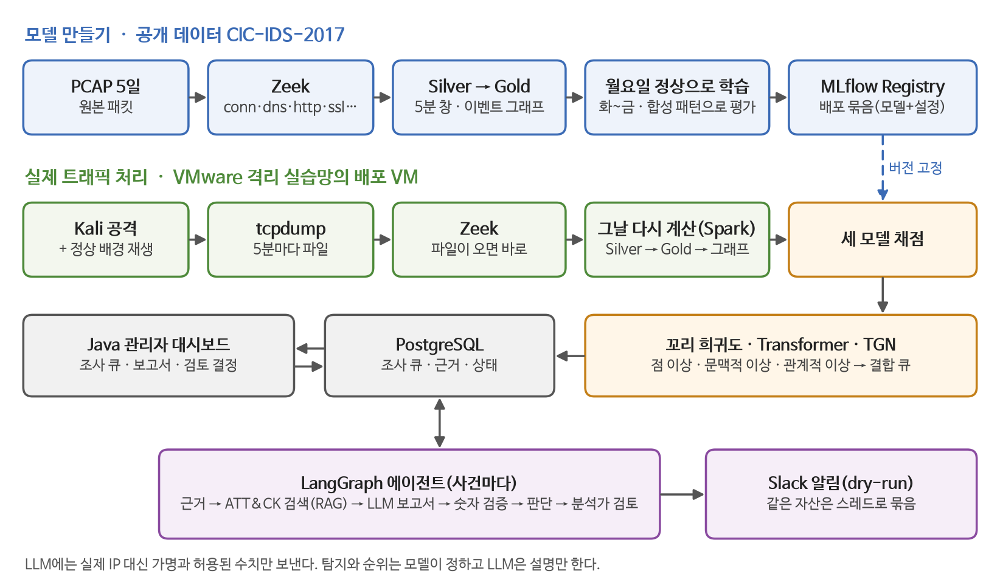

# NBAD 한 장 요약

NBAD(Network Behavior Anomaly Detection)는 Zeek 로그만으로 내부 호스트의 평소와 다른 행동을 찾고 수집부터 조사 큐·보고서·알림까지 자동으로 잇는 시스템이다. 공개 데이터로 모델을 만들고 평가한 뒤 격리된 VMware 실습망에서 실제 트래픽(Kali 공격 + 정상 배경)으로 끝까지 돌려 확인했다. 자세한 내용은 [README](../README.md)에 있다.

## 1. 문제
- 내부망 관제에서 시그니처로 못 잡는 행동(정찰, 측면 이동, beacon, 느린 유출)을 찾고 싶다. 실제 환경에는 공격 라벨이 없다.
- 그래서 정상 트래픽만 배워 평소와 다른 정도를 점수로 매기고 그 점수로 사람이 조사할 순서(조사 큐)를 정하는 문제로 정의했다. 판정이 아니라 조사 순서다. 평가도 정확도나 F1 대신 조사 큐 상위 N건 안에 든 공격 수(Recall@N)로 한다.

## 2. 데이터
- CIC-IDS-2017의 CSV flow 대신 PCAP 5일을 Zeek로 다시 처리했다. CSV 라벨에는 오류가 알려져 있고 관제 현장에서 쓰는 센서는 Zeek다.
- 모델을 정하기 전에 데이터부터 봤다. NAT 주소 편향, 기록 시각과 연결 시작 시각의 차이, 역할 비대칭, 결측과 0바이트, 긴 꼬리를 확인해 진단용 NAT 기준선, `_write_ts` 창, 역할 분리, 결측 분리, `log1p`로 옮겼다([EDA 근거](eda-design-evidence.md)).
- 정답은 Zeek 연결 기준으로 다시 만들었다. 확정 에피소드 16건이고 여기에 합성 패턴 20건을 주입해 따로 평가했다. 정답 조건이 주소·포트·시각 수준이라 독립 검증된 정답이라고 부르지 않는다.
- 월요일(정상)만 학습에 쓴다(앞 80% 학습, 뒤 20% 임계값용 보류). 화\~금은 평가에만 쓴다.

## 3. 모델

| 모델 | 보는 이상 |
| --- | --- |
| 꼬리 희귀도 | 점 이상: 창 하나가 정상 분포에서 얼마나 드문가 |
| Transformer | 문맥적 이상: 이 자산의 직전 1시간 흐름과 비교해 다른가 |
| TGN | 관계적 이상: 누가 누구와 연결하는가(IP 노드, 연결 엣지) |

- 통계 모델은 창 하나만 본다. 이 데이터의 공격은 직전 흐름과 달라지는 모습과 평소 없던 상대와의 연결로도 드러나서 Transformer와 TGN을 더했다. 두 모델 코드는 PyTorch로 실습 노트북에서 작성해 옮겼다.
- Transformer는 학습 창이 1,286개뿐이라 Ridge 회귀와 따로 비교했고 예측 오차가 같은 수준이었다. 이 규모에서 복잡도가 성능으로 이어지지 않았다고 그대로 적었다.
- 세 모델은 점수 척도가 달라 정규화해 더하면 Transformer가 상위를 독차지했다. 그래서 하루 큐를 순위대로 번갈아 합쳤다. 상위 10에서는 단독 최고보다 낮고 상위 50에서는 가장 높다.
- 손으로 만든 행동 탐지기는 first-seen까지 만들고 멈췄다. 대신 로그 특징(18개 → 42개)과 재학습에 시간을 썼고 NAT 연결 수만 진단용 기준선으로 남겼다.

## 4. 결과

| 큐 | CIC 16건 @10 | CIC @50 | 합성 패턴 20건 @10 | 합성 @50 |
| --- | --- | --- | --- | --- |
| 꼬리 희귀도 | 8/16 | 13/16 | 7/20 | 11/20 |
| Transformer | 8/16 | 11/16 | 4/20 | 11/20 |
| TGN | 11/16(NAT 연결을 빼면 6/16) | 13/16 | 2/20 | 9/20 |
| 결합 v1 | 8/16 | **14/16** | 5/20 | **13/20** |
| 자명한 기준선(NAT 주소와의 연결 수) | 12/16 | 13/16 | — | — |

- 16·20건이라 모든 구간이 겹친다. 모델 사이의 차이를 확실하다고 말할 수 없다. 자명한 NAT 기준선이 행동 모델보다 높다.
- 로그 특징 24개는 화\~금 결과를 본 뒤 더해 평가에 노출됐다. 결합 v1은 평가 때 규칙이고 지금 배포 중인 v2는 겹친 사건을 하나로 합친다.
- 라벨 없는 운영으로 옮겨지는 것은 Recall 숫자가 아니라 행동 유형별 강약과 정상에서 울리는 빈도(약 5%)다. 운영에서는 분석가 결론으로 알림 정밀도를 집계한다.

## 5. 실습망 시연
- NAS 대신 VMware에 배포 VM과 Kali VM을 두고 실습망 카드만 캡처했다. 공격이 실제 데이터에 닿지 않고 파이프라인 자기 트래픽이 섞이지 않는다.
- 실습망에는 평소 정상이 없어 CIC 월요일 재생과 합성 정상 클라이언트로 35분 배경을 만들고 공격을 중간에 넣었다. 모델은 다시 학습하지 않았다.
- 같은 정상 트래픽을 넣으면 VM에서 실시간으로 도는 처리의 점수가 배치와 순위 상관 0.70\~0.83이다.
- Kali 포트 스캔은 배경이 있든 없든 꼬리 희귀도·Transformer가 매번 잡았다. 보고서의 숫자는 관측과 맞았다.
- TGN은 스캔당한 서버와 통신한 정상 클라이언트도 함께 꼽았다(그래프 이웃 전파의 한계). 큐 1위는 드문 정상 창이었고 공격 사건은 6·7위였다.
- 그 뒤 센서를 실습망 세그먼트 전체로 넓히고(배포 VM이 당사자가 아닌 통신까지 관측) 공격 대상 호스트를 더해, Kali와 대상 VM으로 성격이 다른 공격의 트래픽을 발생시켰다(첫 시연의 스캔을 합쳐 여덟 가지, 13회) — 포트 스캔(빠름·서비스·느림), SMB 공유 탐색, 분할 유출, 무차별 대입, 비커닝, DNS 터널(비커닝·유출은 침해된 대상 VM에서 보냄).
- 공격을 정답으로 두고 알림 기록에서 쟀다([탐지 결과](lab-attack-detection.md)). 포트·호스트로 퍼지는 4종(스캔 3종, 공유 탐색)은 첫 연결 뒤 3.6\~15.2분에 알림까지 갔다(공유 탐색은 세 모델 모두 꼽았고 그동안 조용하던 TGN이 처음 임계값을 넘었다). 비커닝·유출·DNS 터널·무차별 대입은 알림으로 이어지지 않았다. 새 자산인 대상 VM은 공격이 없어도 늘 후보여서 거기서 시작한 비커닝·유출이 평소와 구분되지 않았다.
- 오탐 튜닝: 대상 VM의 NetBIOS 브로드캐스트 한 건이 5분마다 사건이 됐다(유휴 3일의 사건 271건 전부). 모델·특징은 두고 큐 자격만 정해(브로드캐스트·멀티캐스트행 연결만 있고 창당 25개 이하인 창은 큐에서 뺌, DD-021) 유휴 271 → 0건, 공격한 날 88 → 21건으로 줄였고 공격 사건은 사라지지 않았다. 배포한 뒤 다시 돌리자 묻혀 있던 비커닝·분할 유출이 따로 사건이 되어 7분대에 알림이 나갔고 분할 유출은 "잡힘"이 됐다. 무차별 대입·DNS 터널은 연결 수·DNS 질의 같은 특징이 이미 있는데도 그 값이 정상과 구별될 만큼 드물지 않아 넘기지 못했고(무차별 대입은 시험이 실제 비밀번호를 시도하지 않은 탓도 있다), 비커닝만 시간 간격의 규칙성 특징이 없다. 이 공격들은 벤치마크가 아니라 "무엇을 왜 못 보는가"를 실제 트래픽으로 규명하는 정성적 프로브다.

## 6. LLM 에이전트와 운영
- 탐지와 순위는 모델이 정하고 LLM은 설명만 한다. LLM에는 가명과 허용 수치만 보내고 주장마다 근거 번호를 달게 해 숫자를 코드로 검증한다. 실패하면 템플릿 보고서로 대신한다(평가 30건 중 LLM 28건).
- ATT&CK 검색은 BM25와 비교해 hit@5가 높은 Gemini 임베딩(0.938)을 골랐다. 알림은 LLM을 기다리지 않고 템플릿으로 먼저 보낸다.
- 전송 판단 모델은 그림자 비교에서 공격 관련 사건 11건을 바로 보내지 않아 전송은 정책 규칙에 맡겼다.
- 배포 묶음 = 세 모델 + 전처리 + 특징 스키마 + 임계값 + 사건 정책 + 코드 해시. 등록 전 재현 검사(차이 0), 교체 → 롤백 → 재교체 확인, worker 장애 복구 시험 9/9 통과.
- 관리자 대시보드(Java)는 별도 저장소 [nbad-dashboard](https://github.com/prosild/nbad-dashboard)에 있다.

## 7. 하지 않은 것
- 실습망 데이터로 다시 학습하지 않았다. 정식 Structured Streaming 대신 파일 단위로 처리한다. Slack은 dry-run이다. 드리프트 감시와 새 환경 임계값 재설정은 없다.
- 설계를 바꾼 결정 22건은 [설계 결정](design-decisions/)에, 설계 질문·이의와 판단 근거는 [설계 토론 기록](design-discussion-log.md)에, 단계마다 한 일과 실패한 것은 [진행 기록](README.md)에 남겼다. 개발에는 AI 코딩 도구를 함께 썼고 설계를 바꿀 때마다 결정 문서를 남겼다.
- 데이터: CIC-IDS-2017(UNB CIC, Sharafaldin 외 2018), 개선 라벨(Engelen 외 2021, Liu 외 2022).
