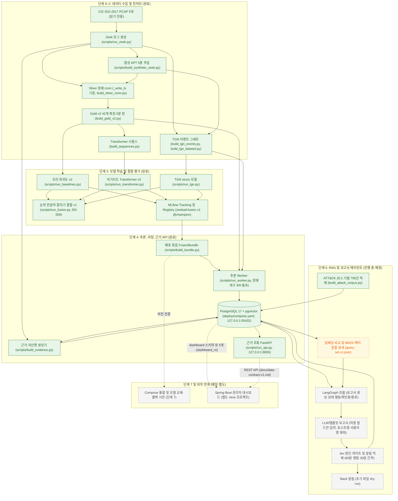
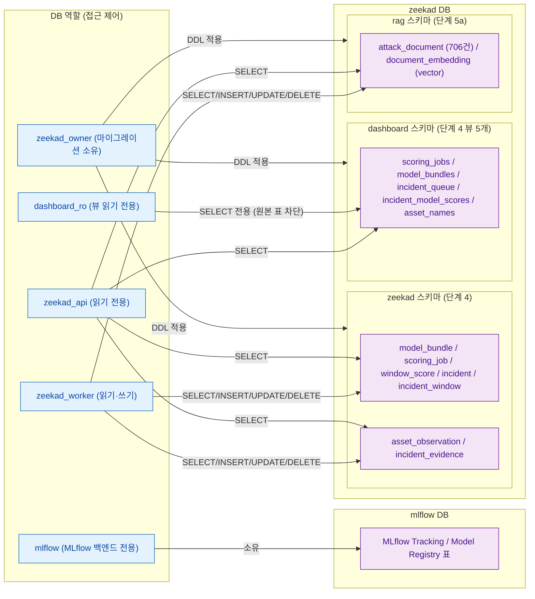

# NBAD 프로젝트 구조도 (2026-11-13 기준, 당시 이름 `zeek_AD`)

현재 코드베이스와 [stage-4-progress.md](stage-4-progress.md), [stage-5-progress.md](stage-5-progress.md), [session-handoff.md](session-handoff.md) 기준으로 정리한 시스템 파이프라인과 PostgreSQL DB 구조입니다.

- 실선(녹색): 구현·검증 완료
- 점선(노랑): 진행 중
- 점선(회색): 예정 또는 별도 프로젝트

---

## 1. 전체 파이프라인 및 서비스 구조

---

## 2. PostgreSQL DB 스키마 및 계정 권한 구조

단일 PostgreSQL 인스턴스(`pgvector/pgvector:0.8.1-pg17`) 내부의 DB·스키마·계정 분리 구조입니다([001_core.sql](../db/migrations/001_core.sql), [002_evidence_dashboard.sql](../db/migrations/002_evidence_dashboard.sql), [003_rag.sql](../db/migrations/003_rag.sql)).

---

## 3. 구현 현황 요약

- **완료(단계 0\~4):** Zeek v2 로그 처리, 합성 APT 5종 주입, Gold v2 + 시퀀스 + TGN 그래프 생성, 세 모델 평가 및 결합 v1([DD-009](design-decisions/DD-009-rank-interleave-fusion.md)), MLflow PostgreSQL 백엔드 이전, `zeekad-fusion` v1 등록, 추론 worker(작업 8개·장애 복구 9/9 통과), `incident_evidence`·`asset_observation`·FastAPI 근거 API(12/12 통과) 및 대시보드 뷰 계약([data-contract-v1.md](data-contract-v1.md)) 완료.
- **진행 중(단계 5a):** `rag.attack_document` 706건 적재 완료([build_attack_corpus.py](../scripts/build_attack_corpus.py)), [query-set.v1.json](../configs/rag/query-set.v1.json) 초안 상태. 다음은 질의 세트 확정 후 임베딩 비교 및 검색 평가.
- **예정(단계 5b·7):** LangGraph(상태 흐름·보고서·Jev·Slack dry-run), Docker Compose 통합 및 모델 교체·롤백 시연, 별도 Java 대시보드 프롬프트 생성([java-admin-dashboard-requirements.md](java-admin-dashboard-requirements.md)).
